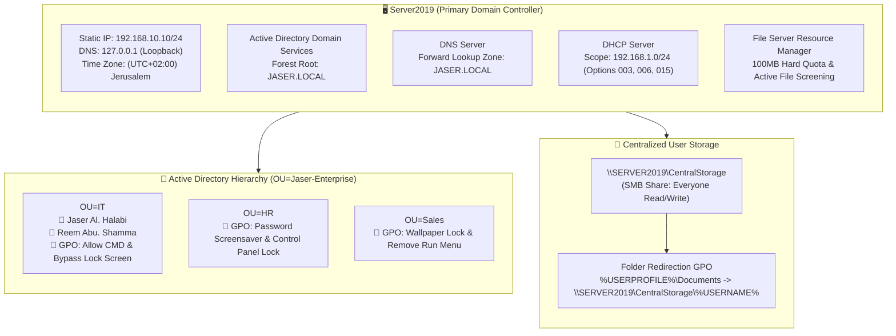

# Enterprise Network Infrastructure & Security Hardening
### Windows Server 2019 Portfolio & Hands-On Engineering Log

---

## 👨‍💻 About This Portfolio

Welcome to my **Windows Server 2019 Enterprise Network Infrastructure & Security Hardening** portfolio.

This repository serves as a documented proof-of-work showcasing my practical, hands-on systems administration and cybersecurity capabilities. I built, configured, secured, and validated a complete Active Directory enterprise environment from scratch using **Windows Server 2019 Datacenter**.

Rather than using automated deployment templates, every component in this lab was manually deployed, configured, tuned, and verified through Windows Server management consoles (**Server Manager, MMC, DNS Manager, DHCP Console, Group Policy Management, and File Server Resource Manager**).

---

## 🗺️ Lab Architecture & Network Topology

---

## 📅 Day-by-Day Implementation & Evidence Log

Below is the complete 9-day chronological log of the work I performed, complete with implementation steps, technical rationales, and verified screenshots from my lab report:

| Day | Module / Task | What I Configured | Visual Verification |
| :---: | :--- | :--- | :---: |
| [**Day 01**](docs/day-01-server-preconfig-and-networking.md) | **Server Pre-Configuration & Static Networking** | Set hostname to `Server2019`, assigned static IPv4 `192.168.10.10/24`, configured loopback DNS `127.0.0.1`, and synced time zone to `(UTC+02:00) Jerusalem` for Kerberos. | [Screenshot](docs/day-01-server-preconfig-and-networking.md#visual-evidence--ui-verification) |
| [**Day 02**](docs/day-02-adds-role-and-forest-promotion.md) | **AD DS Role & Forest Promotion** | Installed AD DS binaries and promoted `Server2019` to the root Domain Controller for the new forest `JASER.LOCAL`. | [Screenshot](docs/day-02-adds-role-and-forest-promotion.md#visual-evidence--ui-verification) |
| [**Day 03**](docs/day-03-ou-hierarchy-and-user-management.md) | **OU Hierarchy & User Management** | Built custom `Jaser-Enterprise` root OU, created `IT`, `Sales`, and `HR` sub-OUs, and provisioned user accounts (`Jaser Al. Halabi`, `Reem Abu. Shamma`). | [Screenshot](docs/day-03-ou-hierarchy-and-user-management.md#visual-evidence--ui-verification) |
| [**Day 04**](docs/day-04-dns-server-and-service-discovery.md) | **DNS Management & Service Discovery** | Verified AD-integrated Forward Lookup Zone `JASER.LOCAL`, validated SOA/NS records, and checked `_msdcs` SRV service discovery. | [Screenshot](docs/day-04-dns-server-and-service-discovery.md#visual-evidence--ui-verification) |
| [**Day 05**](docs/day-05-dhcp-scope-and-enterprise-options.md) | **DHCP Server Configuration** | Provisioned IPv4 scope `192.168.1.0/24` and configured Option 003 (Router), Option 006 (DNS), and Option 015 (Domain Name). | [Screenshot](docs/day-05-dhcp-scope-and-enterprise-options.md#visual-evidence--ui-verification) |
| [**Day 06**](docs/day-06-departmental-group-policy-hardening.md) | **Departmental Group Policy Hardening** | Enforced least privilege across departments: HR (screen lock & Control Panel restriction), IT (CMD allowed), Sales (wallpaper lock & Run removal). | [Screenshot](docs/day-06-departmental-group-policy-hardening.md#visual-evidence--ui-verification) |
| [**Day 07**](docs/day-07-centralized-folder-redirection.md) | **Centralized Data Redirection (GPO)** | Created `\\SERVER2019\CentralStorage`, configured NTFS permissions, deployed GPO Folder Redirection for `Documents`, and verified per-user folder creation. | [Screenshot](docs/day-07-centralized-folder-redirection.md#visual-evidence--ui-verification) |
| [**Day 08**](docs/day-08-advanced-storage-fsrm-quotas.md) | **Advanced Storage Management (FSRM)** | Installed FSRM and enforced a 100 MB Hard Quota on `C:\CentralStorage` to protect the OS disk against volume exhaustion attacks. | [Screenshot](docs/day-08-advanced-storage-fsrm-quotas.md#visual-evidence--ui-verification) |
| [**Day 09**](docs/day-09-active-file-screening-security.md) | **Proactive Security via Active File Screening** | Implemented Active File Screening on `C:\CentralStorage` using the kernel minifilter driver to block non-work multimedia files (`.mp3`, `.mp4`, `.mov`). | [Screenshot](docs/day-09-active-file-screening-security.md#visual-evidence--ui-verification) |

---

## 🧠 "The Small Things": Key Sysadmin & Security Concepts I Applied

Throughout this deployment, I paid careful attention to the nuances that distinguish a production-ready enterprise server from a default setup:

1. **Why I used `127.0.0.1` as DNS on the Domain Controller**:
   Pointing the primary network adapter's DNS to loopback (`127.0.0.1`) ensures that the server queries its own local DNS database during boot, avoiding cold-start timeout loops and Netlogon service delays.
2. **Why I synchronized the time zone for Kerberos**:
   Active Directory authentication uses Kerberos v5, which enforces a strict 5-minute maximum clock skew (`MaxClockSkew`). Aligning the system time ensures tickets are validated without replay errors.
3. **Why I created a dedicated `Jaser-Enterprise` OU instead of using `CN=Users`**:
   The default `CN=Users` and `CN=Computers` folders are basic system containers where Group Policy Objects cannot be directly linked. Creating a dedicated root OU allows clean GPO inheritance and departmental segmentation.
4. **Why I configured DHCP Options 003, 006, and 015**:
   Assigning these options ensures connecting workstations automatically receive their default gateway (`192.168.1.1`), the Domain Controller's DNS (`192.168.10.10`), and the domain suffix (`JASER.LOCAL`) without any manual client configuration.
5. **Why I implemented Department-Specific GPOs**:
   Instead of applying broad domain-wide restrictions, I used the **LSDOU** inheritance model to enforce tight security on HR (protecting PII data), give operational tools to IT, and standardize the Sales desktop environment.
6. **Why I used FSRM Hard Quotas and Kernel-Level Active File Screening**:
   A Hard Quota physically stops write operations with `ERROR_DISK_FULL` when reaching 100MB, preventing storage denial-of-service. Active File Screening leverages the kernel minifilter driver (`srmfltr.sys`) to block unauthorized file types before they are written to disk.

---

## 👤 Portfolio Metadata
- **Prepared By**: Jaser Halabi
- **Course**: Cybersecurity & Network Engineering
- **Lab Date**: April 9, 2026
- **Operating System**: Windows Server 2019 Datacenter
