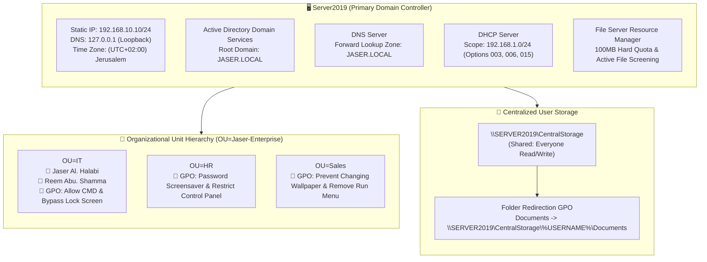

# Enterprise Network Infrastructure & Security Hardening
### Windows Server 2019 Deployment & Administration Lab Report

---

## 🏛️ Lab Overview

This repository contains the comprehensive lab report and documentation for the deployment, configuration, and security hardening of an enterprise network infrastructure using **Windows Server 2019**.

All configurations and verifications were executed and validated manually across core Windows Server management consoles: **Server Manager, Active Directory Users and Computers, DNS Manager, DHCP Console, Group Policy Management, and File Server Resource Manager**.

---

## 🌐 Network Infrastructure Architecture

---

## 📅 Table of Contents & Implementation Log

| Section / Day | Module Title | Objective & Implementation Summary | Visual Verification |
| :---: | :--- | :--- | :---: |
| [**Day 01**](docs/day-01-server-preconfig-and-networking.md) | **Section 1.0: Server Pre-Configuration & Static Networking** | Renamed hostname to `Server2019`, assigned static IPv4 address `192.168.10.10/24`, configured DNS `127.0.0.1`, and set time zone to `(UTC+02:00) Jerusalem`. | [View Screenshot](docs/day-01-server-preconfig-and-networking.md#13-visual-evidence--verification) |
| [**Day 02**](docs/day-02-adds-role-and-forest-promotion.md) | **Section 2.0: Active Directory Domain Services (AD DS)** | Installed the AD DS role and promoted the server to a Domain Controller for the new forest `JASER.LOCAL`. | [View Screenshots](docs/day-02-adds-role-and-forest-promotion.md#23-visual-evidence--verification) |
| [**Day 03**](docs/day-03-ou-hierarchy-and-user-management.md) | **Section 3.0: Organizational Unit (OU) & User Management** | Created top-level OU `Jaser-Enterprise`, sub-OUs for `IT`, `Sales`, and `HR`, and provisioned user accounts (`Jaser Al. Halabi`, `Reem Abu. Shamma`). | [View Screenshot](docs/day-03-ou-hierarchy-and-user-management.md#33-visual-evidence--verification) |
| [**Day 04**](docs/day-04-dns-server-and-service-discovery.md) | **Section 4.0: DNS Management** | Verified the automated installation and health of DNS, the `JASER.LOCAL` Forward Lookup Zone, and Host (A) record mapping to `192.168.10.10`. | [View Screenshot](docs/day-04-dns-server-and-service-discovery.md#43-visual-evidence--verification) |
| [**Day 05**](docs/day-05-dhcp-scope-and-enterprise-options.md) | **Section 5.0: DHCP Server Configuration** | Configured dedicated IPv4 scope `192.168.1.0/24` with standard options: 003 Router (`192.168.1.1`), 006 DNS (`192.168.10.10`), and 015 Domain Name (`JASER.LOCAL`). | [View Screenshot](docs/day-05-dhcp-scope-and-enterprise-options.md#53-visual-evidence--verification) |
| [**Day 06**](docs/day-06-departmental-group-policy-hardening.md) | **Section 6.0: Departmental Group Policy Implementation** | Implemented targeted GPOs across `HR`, `IT`, and `Sales` OUs to enforce departmental security and access baselines. | [View Screenshot](docs/day-06-departmental-group-policy-hardening.md#63-visual-evidence--verification) |
| [**Day 07**](docs/day-07-centralized-folder-redirection.md) | **Section 7.0: Centralized Data Redirection (GPO)** | Created `\\SERVER2019\CentralStorage` network share, configured GPO Folder Redirection for `Documents`, and verified per-user folder creation. | [View Screenshots](docs/day-07-centralized-folder-redirection.md#73-visual-evidence--verification) |
| [**Day 08**](docs/day-08-advanced-storage-fsrm-quotas.md) | **Section 8.0: Advanced Storage (FSRM)** | Implemented File Server Resource Manager with a 100 MB Hard Quota on `C:\CentralStorage` to protect the volume from disk exhaustion. | [View Screenshot](docs/day-08-advanced-storage-fsrm-quotas.md#83-visual-evidence--verification) |
| [**Day 09**](docs/day-09-active-file-screening-security.md) | **Section 9.0: Proactive Security via File Screening** | Implemented Active File Screening on `C:\CentralStorage` using the "Block Audio and Video Files" template to intercept unauthorized media writes. | [View Screenshot](docs/day-09-active-file-screening-security.md#93-visual-evidence--verification) |

---

## 👤 Report Metadata
- **Prepared By**: Jaser Halabi
- **Course**: Cybersecurity & Network Engineering
- **Date**: April 9, 2026
- **Operating System**: Windows Server 2019
