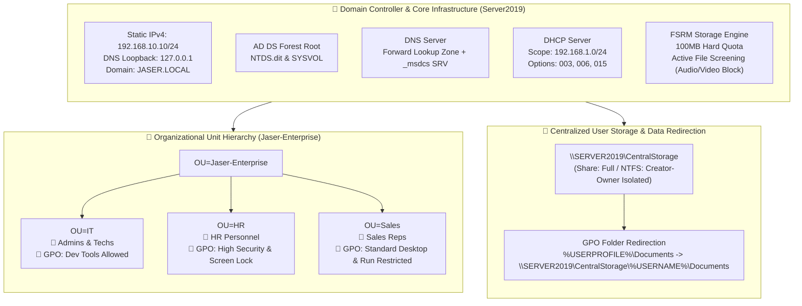

# Enterprise Network Infrastructure & Security Hardening
### Windows Server 2019 Production Deployment & Administration Lab

[](https://www.microsoft.com/en-us/windows-server)
[](https://learn.microsoft.com/en-us/windows-server/identity/ad-ds/active-directory-domain-services)
[](https://learn.microsoft.com/en-us/windows-server/security/windows-server-security)
[](https://github.com/)

---

## 🏛️ Executive Summary

This repository documents the end-to-end deployment, identity architecture, network automation, and security hardening of an enterprise environment built on **Windows Server 2019**. 

Designed as a **9-Day Modular Implementation Sprint**, this project transitions from low-level host initialization and Active Directory forest architecture to departmental Group Policy enforcement, centralized user profile redirection, and kernel-level storage defense via File Server Resource Manager (FSRM).

Each day breaks down not just **what** was configured, but **why** it was designed that way, explaining the underlying Windows Server internals, Kerberos authentication constraints, DNS/DHCP integration mechanics, NTFS vs SMB security models, and storage minifilter drivers.

---

## 🌐 Enterprise Lab Topology & Architecture



---

## 📅 9-Day Implementation Sprint Index

| Sprint Day | Module | Core Technologies | Primary Focus / System Internals |
| :--- | :--- | :--- | :--- |
| [**Day 01**](docs/day-01-server-preconfig-and-networking.md) | **Server Pre-Configuration & Static Networking** | TCP/IP, DNS Loopback, Kerberos | Hostname standardization (`Server2019`), static IPv4 allocation, DNS loopback dependency chains, and Kerberos 5-minute clock skew protection (`MaxClockSkew`). |
| [**Day 02**](docs/day-02-adds-role-and-forest-promotion.md) | **AD DS Role Provisioning & Forest Promotion** | Active Directory, ESE, FSMO | Role installation via DISM, forest root promotion (`JASER.LOCAL`), `NTDS.dit` database creation, `SYSVOL` replication shares, and FSMO role seeding. |
| [**Day 03**](docs/day-03-ou-hierarchy-and-user-management.md) | **Enterprise OU Hierarchy & Identity Management** | LDAP, OUs, Security Accounts | Custom `OU=Jaser-Enterprise` vs un-linkable `CN=Users` containers, departmental segmentation (IT, Sales, HR), UPN formatting, and accidental deletion locks. |
| [**Day 04**](docs/day-04-dns-server-and-service-discovery.md) | **DNS Management & Active Directory Service Locator** | DNS, SRV, SOA, Dynamic Updates | AD-Integrated Forward Lookup Zones, Host (A) records, SOA serial validation, and `_msdcs` SRV record service discovery (`_ldap`, `_kerberos`). |
| [**Day 05**](docs/day-05-dhcp-scope-and-enterprise-options.md) | **DHCP Automation & Enterprise Scope Architecture** | DHCP, DORA, Scope Options | Active Directory DHCP authorization (`Add-DhcpServerInDC`), Scope `192.168.1.0/24`, Default Gateway (003), DNS Server (006), and Domain Suffix (015). |
| [**Day 06**](docs/day-06-departmental-group-policy-hardening.md) | **Departmental Group Policy (GPO) Hardening** | GPO, LSDOU, Admin Templates | Granular baseline enforcement per department: HR password screensavers & Control Panel lock, IT CLI access, Sales wallpaper lock & Run command removal. |
| [**Day 07**](docs/day-07-centralized-folder-redirection.md) | **Centralized Data Redirection & Profile Isolation** | SMB 3.0, NTFS DACLs, Offline Files | Redirecting `%USERPROFILE%\Documents` to `\\SERVER2019\CentralStorage`, configuring explicit NTFS inheritance and `CREATOR OWNER` DACLs for total data isolation. |
| [**Day 08**](docs/day-08-advanced-storage-fsrm-quotas.md) | **Advanced Storage Management (FSRM Quotas)** | FSRM, Storage Quotas, I/O Limits | Hard Quotas (100 MB Limit) on `C:\CentralStorage`, filesystem-level write rejection (`ERROR_DISK_FULL`), protecting server volumes from storage exhaustion. |
| [**Day 09**](docs/day-09-active-file-screening-security.md) | **Proactive Security via Active File Screening** | FSRM Minifilter Driver (`srmfltr.sys`) | Kernel-level I/O write interception, blocking non-business media extensions (`.mp3`, `.mp4`, `.mov`, `.avi`), zero performance overhead file control. |

---

## ⚡ PowerShell Infrastructure-as-Code (IaC)

All deployment phases in this repository are accompanied by production-ready, idempotent PowerShell scripts located in [`powershell/`](powershell/):

```text
powershell/
├── 01-Server-PreConfig.ps1          # Hostname, Static IPv4, DNS Loopback, Timezone
├── 02-ADDS-Deployment.ps1           # AD DS Role & Forest Root Deployment (JASER.LOCAL)
├── 03-OU-and-User-Provisioning.ps1  # Enterprise OU Hierarchy & User Account Provisioning
├── 04-DNS-Configuration.ps1        # DNS Zone Validation & Host A Record Management
├── 05-DHCP-Configuration.ps1       # AD-Authorized DHCP Server & Scope Setup
├── 06-Group-Policy-Management.ps1   # Departmental GPOs (HR, IT, Sales) & Links
├── 07-Folder-Redirection-Storage.ps1# SMB Share & NTFS Security ACL Architecture
├── 08-FSRM-Quota-Management.ps1     # FSRM Installation & 100MB Hard Quota Policy
└── 09-FSRM-Active-File-Screening.ps1# Active File Screening (Audio/Video Blacklist)
```

---

## 🔍 Key Windows Server 2019 Engineering Concepts Demonstrated

1. **Active Directory & Identity Design**:
   - Proper logical OU structuring avoiding legacy `CN=Users` containers to ensure clean Group Policy inheritance.
   - User Principal Name (`user@jaser.local`) standardized identity conventions with secure password handling.
2. **Network Services Cohesion**:
   - Active Directory-Integrated DNS ensuring high-availability name resolution and dynamic SRV registration.
   - Authorized DHCP server preventing rogue DHCP servers on the physical network.
3. **Enterprise Group Policy Architecture**:
   - Strict adherence to the **LSDOU** (Local -> Site -> Domain -> Organizational Unit) precedence model.
   - Separation of administrative duties: providing developer/admin tools to IT while locking down standard end-user attack surfaces (Control Panel, Run Dialog).
4. **Data Protection & Storage Governance**:
   - Automated folder redirection ensuring user data resides safely on centralized, backed-up server storage.
   - Principle of Least Privilege applied to file shares: Share Permissions (`Everyone: Read/Write`) paired with strict NTFS DACLs (`CREATOR OWNER: Full Control`).
   - File Server Resource Manager (FSRM) active enforcement at the file system filter driver layer (`srmfltr.sys`), rejecting unauthorized write I/O before touching disk blocks.

---

## 🚀 How to Replicate This Environment

### Prerequisites
- **Hypervisor**: VMware ESXi, Hyper-V, or VirtualBox
- **Virtual Machine Specifications**:
  - OS: Windows Server 2019 Datacenter / Standard (Core or Desktop Experience)
  - vCPU: 2+ Cores
  - RAM: 4 GB+
  - Storage: 60 GB+ VHDX (NTFS Formatted)
  - Network Adapter: Internal Host-Only / Private VSwitch

### Deployment Execution
Run the automated PowerShell scripts sequentially from an elevated Administrative PowerShell session:

```powershell
# 1. Base Configuration & Static IP
.\powershell\01-Server-PreConfig.ps1

# 2. AD DS Forest Promotion (Triggers automated restart)
.\powershell\02-ADDS-Deployment.ps1

# 3. Enterprise Structure & Identity
.\powershell\03-OU-and-User-Provisioning.ps1

# 4. Core Network Services
.\powershell\04-DNS-Configuration.ps1
.\powershell\05-DHCP-Configuration.ps1

# 5. Policy Hardening & Storage Security
.\powershell\06-Group-Policy-Management.ps1
.\powershell\07-Folder-Redirection-Storage.ps1
.\powershell\08-FSRM-Quota-Management.ps1
.\powershell\09-FSRM-Active-File-Screening.ps1
```

---

## 👤 Author & Lab Metadata
- **Engineer**: Jaser Halabi
- **Specialization**: Cybersecurity & Network Engineering
- **Project Completion**: April 9, 2026
- **Target OS**: Windows Server 2019 Datacenter (Build 17763)
