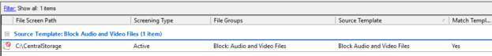

# Active File Screening & Storage Security

---

## 🎯 9.1 Objective
To implement **Active File Screening** within the FSRM role. This ensures that the server storage is used strictly for business-critical documents and prevents the storage of non-authorized media files (Audio/Video), which protects both storage capacity and network bandwidth.

---

## 🛠️ 9.2 Implementation Details

- **Screening Type**: **Active Screening** (Prevents users from saving unauthorized files).
- **File Groups**: Applied the **"Block Audio and Video Files"** template to the **`C:\CentralStorage`** path.
- **Mechanism**: The FSRM filter driver intercepts I/O requests; if a file extension matches the blocked group (e.g., `.mp3`, `.mp4`, `.mov`), the write operation is rejected at the kernel level.

---

## 📸 9.3 Visual Evidence & Verification

### Verification Details from File Server Resource Manager:
- **`File Screen Path`**: `C:\CentralStorage`
- **`Screening Type`**: `Active`
- **`File Groups`**: `Block Audio and Video Files`
- **`Source Template`**: `Block Audio and Video Files`
- **`Match Template`**: `Yes`

---

## 📋 9.4 Configuration Summary

| Setting | Value | Verification Status |
| :--- | :--- | :---: |
| **File Screen Path** | `C:\CentralStorage` | ✅ Verified |
| **Screening Type** | `Active` (Blocks unauthorized writes) | ✅ Verified |
| **File Group Blocked** | `Block Audio and Video Files` | ✅ Verified |
| **Source Template** | `Block Audio and Video Files` | ✅ Verified |
| **Match Template** | `Yes` | ✅ Verified |
