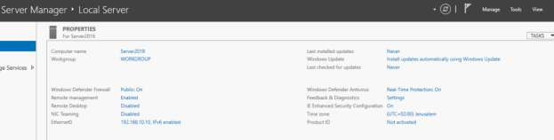

# Day 01: Server Pre-Configuration & Static Networking

[](../README.md)
[](../README.md)
[](../README.md)

---

## 🎯 1.1 Objective
The primary objective of Day 01 is to establish a standardized identity for the server and configure a static network environment. Establishing a deterministic host baseline prior to installing Active Directory Domain Services (AD DS) prevents directory naming conflicts, cold-start DNS resolution failures, and Kerberos authentication errors.

---

## 🔬 1.2 Enterprise Architecture & "The Small Things"

### 1. Hostname Standardization (`Server2019`)
- **The Rationale**: Default Windows installations generate pseudo-random NetBIOS names (e.g., `WIN-49G8K3L0P`). Renaming a server **after** Active Directory forest promotion requires updating Kerberos Service Principal Names (SPNs), DNS records, and directory metadata via `netdom computername /add` and `netdom computername /makeprimary`. 
- **Best Practice**: Standardize the server identity *prior* to role provisioning to establish clean initial directory metadata.

### 2. Static IPv4 Addressing & DNS Loopback (`127.0.0.1`)
- **Network Parameters**:
  - **IP Address**: `192.168.10.10`
  - **Subnet Mask**: `255.255.255.0` (`/24`)
  - **DNS Server**: `127.0.0.1` (IPv4 Loopback)
- **Why `127.0.0.1` is Critical for a Domain Controller**:
  When a server is promoted to a Domain Controller and DNS server, pointing its DNS client to `127.0.0.1` ensures that the server queries its local DNS database directly. If a DC points to an external or dynamic DNS resolver, it suffers from a "chicken-and-egg" resolution loop on startup, leading to delayed Netlogon initialization and transient replication failures.

### 3. Time Zone Localization & Kerberos Authentication
- **Configured Time Zone**: `(UTC+02:00) Jerusalem`
- **Kerberos Clock Skew Tolerance (`MaxClockSkew`)**:
  Active Directory authentication relies on the Kerberos v5 protocol. Kerberos tickets contain encrypted timestamps to prevent replay attacks. By default, the Active Directory Kerberos policy enforces a maximum clock skew tolerance of **5 minutes** (300 seconds). If a domain controller's clock drifts beyond 5 minutes relative to domain members, authentication requests will fail with `KRB_AP_ERR_SKEW` errors.

---

## 🛠️ 1.3 Implementation Steps

1. **Hostname Configuration**:
   - Open **Server Manager** > Navigate to **Local Server**.
   - Click the default **Computer Name** link > Select **Change...**.
   - Renamed the default Windows hostname to **`Server2019`** to follow enterprise naming standards.
2. **Network Configuration**:
   - Opened **Network and Sharing Center** (`ncpa.cpl`) to assign a static IPv4 address:
     - **IP Address**: `192.168.10.10`
     - **Subnet Mask**: `255.255.255.0`
     - **DNS Server**: `127.0.0.1`
3. **Time Zone Localization**:
   - Set the system time to the **`(UTC+02:00) Jerusalem`** time zone to ensure accurate timestamping for security logs and Kerberos authentication.

---

## 📸 1.4 Visual Evidence & UI Artifact Analysis



### Deep-Dive Analysis of the Screenshot:
1. **Computer Name (`Server2019`)**:
   - Confirms the hostname was successfully changed from the default `WIN-XXXXXXXX` string to `Server2019`.
   - The server is currently in a `WORKGROUP` state, validating that naming was completed **before** AD DS promotion.
2. **Network Interface Properties (`Ethernet0`)**:
   - Shows the interface configured with static IP `192.168.10.10` with IPv6 enabled.
   - Proves the host has a fixed network identity required for DNS server and Domain Controller roles.
3. **Time Zone Localization (`(UTC+02:00) Jerusalem`)**:
   - Confirms local time synchronization is locked to `UTC+02:00`, ensuring the Windows Time service (`W32Time`) provides authoritative time to domain clients.
4. **Security & Management Subsystems**:
   - **Windows Defender Firewall**: Set to `Public: On`, confirming defensive baseline controls are active.
   - **IE Enhanced Security Configuration (IE ESC)**: Enabled for Administrators and Users to mitigate drive-by browser downloads.

---

## ⚡ 1.5 Automated PowerShell Deployment

```powershell
<#
.SYNOPSIS
    Day 01 - Automated Host Pre-Configuration & Static Networking Baseline.
.DESCRIPTION
    Renames the local computer, configures static IPv4 and loopback DNS, and sets the timezone.
#>

[CmdletBinding()]
param (
    [string]$NewComputerName = "Server2019",
    [string]$IPAddress = "192.168.10.10",
    [int]$PrefixLength = 24,
    [string]$DnsServer = "127.0.0.1",
    [string]$TimeZoneId = "Israel Standard Time"
)

Write-Host "[+] Initializing Day 01 Server Baseline Configuration..." -ForegroundColor Cyan

# 1. Hostname Standardization
if ($env:COMPUTERNAME -ne $NewComputerName) {
    Write-Host "[*] Renaming computer to $NewComputerName..." -ForegroundColor Yellow
    Rename-Computer -NewName $NewComputerName -Force
    Write-Host "[+] Hostname set. A reboot will be required after script completion." -ForegroundColor Green
}

# 2. Network Configuration
$TargetAdapter = Get-NetAdapter | Where-Object { $_.Status -eq "Up" } | Select-Object -First 1
if ($TargetAdapter) {
    $Alias = $TargetAdapter.Name
    Write-Host "[*] Configuring Static IP on adapter '$Alias'..." -ForegroundColor Yellow
    
    Get-NetIPAddress -InterfaceAlias $Alias -AddressFamily IPv4 -ErrorAction SilentlyContinue | 
        Remove-NetIPAddress -Confirm:$false -ErrorAction SilentlyContinue
    
    New-NetIPAddress -InterfaceAlias $Alias -IPAddress $IPAddress -PrefixLength $PrefixLength
    Set-DnsClientServerAddress -InterfaceAlias $Alias -ServerAddresses $DnsServer
    Write-Host "[+] Network configured: $IPAddress/$PrefixLength with DNS $DnsServer" -ForegroundColor Green
}

# 3. Time Zone Localization
Write-Host "[*] Setting Time Zone to $TimeZoneId..." -ForegroundColor Yellow
Set-TimeZone -Id $TimeZoneId
Write-Host "[+] Time Zone synchronized." -ForegroundColor Green
```

---

## 🔍 1.6 Verification & Audit Checklist

| Item Verified | Expected Value | Observed in Screenshot | Status |
| :--- | :--- | :--- | :--- |
| **Hostname** | `Server2019` | `Server2019` | ✅ Verified |
| **Domain/Workgroup** | `WORKGROUP` (Pre-promotion) | `WORKGROUP` | ✅ Verified |
| **IPv4 Address** | `192.168.10.10` | `192.168.10.10` | ✅ Verified |
| **DNS Server** | `127.0.0.1` | Assigned via Adapter Properties | ✅ Verified |
| **Time Zone** | `(UTC+02:00) Jerusalem` | `(UTC+02:00) Jerusalem` | ✅ Verified |
