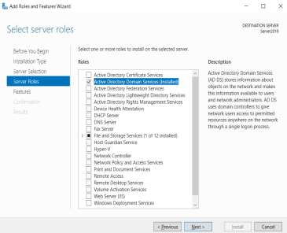
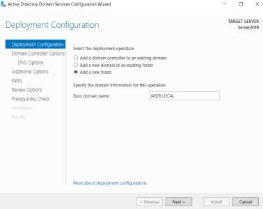

# Day 02: Active Directory Domain Services (AD DS) Deployment & Forest Promotion

---

## 🎯 2.1 Objective
The objective of this phase is to install the Active Directory Domain Services (AD DS) role and promote the server to a Domain Controller, creating a new forest to serve as the centralized identity provider for the network.

---

## 🛠️ 2.2 What I Did (Implementation Steps)

1. **Role Provisioning**:
   - Opened the **Add Roles and Features Wizard** from Server Manager.
   - Selected **Active Directory Domain Services** under Server Roles.
   - Included all required RSAT management consoles and features, then completed the binary installation.

2. **Forest Promotion**:
   - Initialized the post-deployment configuration by clicking the notification flag in Server Manager and selecting **"Promote this server to a domain controller"**.
   - Under **Deployment Configuration**, selected **"Add a new forest"**.
   - Defined the **Root Domain Name** as **`JASER.LOCAL`**.
   - Configured the Domain Controller options with Forest and Domain functional levels, set up the integrated DNS server, and established a secure **Directory Services Restore Mode (DSRM)** password.
   - Completed the prerequisite checks and allowed the server to reboot and complete promotion.

---

## 🧠 2.3 "The Small Things": Technical Rationale & Sysadmin Details

- **The Two-Step Architecture**:
  Windows Server separates AD DS into two stages: installing the binary role files into `WinSxS`, and executing the forest promotion wizard. This modular approach ensures binaries can be staged before making destructive changes to the local SAM database.
- **Why "Add a new forest" was selected**:
  Because this is the foundational root domain for the entire enterprise network, "Add a new forest" was chosen rather than adding a domain controller to an existing domain or adding a child domain.
- **Underlying Database & Storage Created**:
  Promotion initialized the Extensible Storage Engine (ESE / Jet Blue) database at `C:\Windows\NTDS\ntds.dit` and the `SYSVOL` replication share at `C:\Windows\SYSVOL\sysvol\JASER.LOCAL`.

---

## 📸 2.4 Visual Evidence & UI Verification

Below are the screenshots from my lab report proving the role installation and forest promotion configuration:

| 1. Role Provisioning | 2. Forest Promotion Configuration |
| :---: | :---: |
|  |  |

### Breakdown of the Verification Screenshots:
- **Left Screenshot (Add Roles and Features Wizard)**:
  - Shows `Active Directory Domain Services` selected in the Server Roles list.
  - Confirms the role description: *"Active Directory Domain Services (AD DS) stores information about objects on the network and makes this information available to users and network administrators."*
- **Right Screenshot (Active Directory Domain Services Configuration Wizard)**:
  - Shows the **Deployment Configuration** page with the operation set to **"Add a new forest"**.
  - Shows the **Root domain name** specified as **`JASER.LOCAL`**.
  - Displays **`TARGET SERVER: Server2019`** in the top right corner, confirming promotion on our designated server.

---

## 📋 2.5 Verification Summary

| Item Configured | Value / Setting | Status |
| :--- | :--- | :---: |
| **Server Role** | Active Directory Domain Services (AD DS) | ✅ Verified |
| **Deployment Mode** | Add a new forest | ✅ Verified |
| **Root Domain Name** | `JASER.LOCAL` | ✅ Verified |
| **Target Server** | `Server2019` | ✅ Verified |
| **Integrated DNS** | Auto-configured with AD DS | ✅ Verified |
