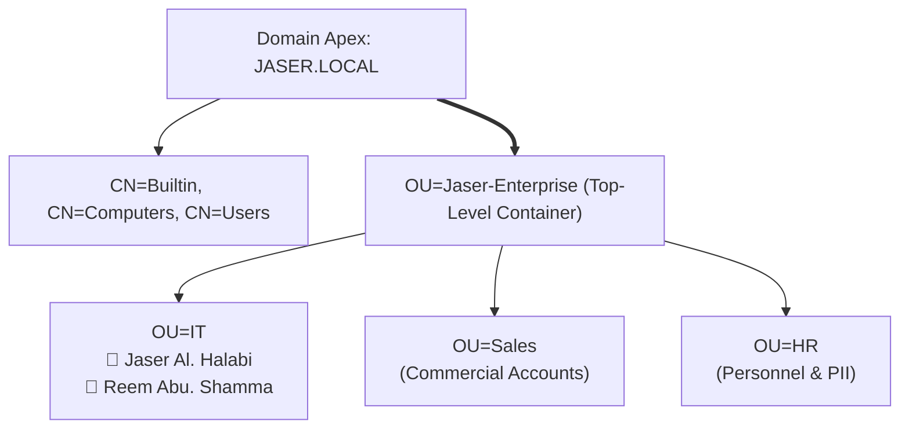

# Day 03: Organizational Unit (OU) & User Management

[](../README.md)
[](../README.md)
[](../README.md)

---

## 🎯 3.1 Objective
The objective of this phase is to design a logical hierarchy that reflects a corporate structure, allowing for granular management of users, computers, and Group Policy Objects (GPOs).

---

## 🔬 3.2 Enterprise Architecture & "The Small Things"

### 1. Root OU vs Default System Containers
- **The Core Problem**: Out of the box, Active Directory places objects into `CN=Users` and `CN=Computers`. These are standard Common Name (`CN`) containers, **not** Organizational Units (`OU`). Group Policy Objects cannot be directly linked to `CN` containers.
- **Root OU Creation**: Established a top-level OU titled **`Jaser-Enterprise`** to separate corporate objects from default system containers.

### 2. Departmental Segmentation & User Provisioning
- **Departmental Segmentation**: Created sub-OUs for **`IT`**, **`Sales`**, and **`HR`** to mirror a standard corporate business model.
- **User Provisioning**: Populated the `IT` OU with initial user accounts:
  - **`Jaser Al. Halabi`** (User)
  - **`Reem Abu. Shamma`** (User)
  Applying enterprise naming conventions, User Principal Names (`user@jaser.local`), and password security protocols.



---

## 🛠️ 3.3 Implementation Steps

1. **Root OU Creation**:
   - Open **Active Directory Users and Computers** (`dsa.msc`).
   - Right-click `JASER.LOCAL` > **New** > **Organizational Unit**.
   - Name: `Jaser-Enterprise`. Ensure *Protect container from accidental deletion* is checked.
2. **Departmental Sub-OUs**:
   - Right-click `Jaser-Enterprise` > **New** > **Organizational Unit**.
   - Created three departmental sub-OUs: `IT`, `Sales`, and `HR`.
3. **User Account Provisioning**:
   - Navigate to `JASER.LOCAL` > `Jaser-Enterprise` > `IT`.
   - Right-click > **New** > **User**:
     - User 1: Full Name `Jaser Al. Halabi`, Logon Name `jhalabi`.
     - User 2: Full Name `Reem Abu. Shamma`, Logon Name `rshamma`.
   - Applied enterprise password requirements.

---

## 📸 3.4 Visual Evidence & UI Artifact Analysis


### Deep-Dive Analysis of the Screenshot:
1. **Directory Tree Pane (Left Window)**:
   - **`JASER.LOCAL`**: Shows the domain root with standard system containers (`Builtin`, `Computers`, `Domain Controllers`, `ForeignSecurityPrincipals`, `Managed Service Accounts`, `Users`).
   - **`Jaser-Enterprise` Root OU**: Visibly created directly beneath `JASER.LOCAL` with the characteristic folder-and-document OU icon.
   - **Departmental Sub-OUs**: Expanded under `Jaser-Enterprise` showing the three sub-OUs:
     - 📁 `IT` (Highlighted / Active selection)
     - 📁 `Sales`
     - 📁 `HR`
2. **Object Details Pane (Right Window)**:
   - Displays the contents of `OU=IT,OU=Jaser-Enterprise,DC=JASER,DC=LOCAL`:
     - **`Jaser Al. Halabi`** | Type: `User`
     - **`Reem Abu. Shamma`** | Type: `User`
   - Confirms successful provisioning of individual user accounts inside the IT departmental boundary.

---

## ⚡ 3.5 Automated PowerShell Deployment

```powershell
<#
.SYNOPSIS
    Day 03 - Automated Enterprise OU Hierarchy & User Account Provisioning.
#>

Import-Module ActiveDirectory

$RootOUPath = "DC=JASER,DC=LOCAL"
$RootOUName = "Jaser-Enterprise"
$FullRootOU = "OU=$RootOUName,$RootOUPath"

# 1. Root OU
if (-not (Get-ADOrganizationalUnit -Filter "Name -eq '$RootOUName'" -ErrorAction SilentlyContinue)) {
    New-ADOrganizationalUnit -Name $RootOUName -Path $RootOUPath -ProtectedFromAccidentalDeletion $true
}

# 2. Sub-OUs
@("IT", "Sales", "HR") | ForEach-Object {
    if (-not (Get-ADOrganizationalUnit -Filter "Name -eq '$_'" -SearchBase $FullRootOU -ErrorAction SilentlyContinue)) {
        New-ADOrganizationalUnit -Name $_ -Path $FullRootOU -ProtectedFromAccidentalDeletion $true
    }
}

# 3. User Accounts in IT OU
$ITPath = "OU=IT,$FullRootOU"
$SecurePass = ConvertTo-SecureString "EnterpriseSecure2026!" -AsPlainText -Force

$Users = @(
    @{ Name = "Jaser Al. Halabi"; First = "Jaser"; Last = "Al. Halabi"; Sam = "jhalabi"; UPN = "jhalabi@jaser.local" },
    @{ Name = "Reem Abu. Shamma"; First = "Reem"; Last = "Abu. Shamma"; Sam = "rshamma"; UPN = "rshamma@jaser.local" }
)

foreach ($u in $Users) {
    if (-not (Get-ADUser -Filter "SamAccountName -eq '$($u.Sam)'" -ErrorAction SilentlyContinue)) {
        New-ADUser -Name $u.Name -GivenName $u.First -Surname $u.Last -DisplayName $u.Name `
                   -SamAccountName $u.Sam -UserPrincipalName $u.UPN -Path $ITPath `
                   -AccountPassword $SecurePass -Enabled $true
    }
}
```

---

## 🔍 3.6 Verification & Audit Checklist

| Item Verified | Expected Value | Observed in Screenshot | Status |
| :--- | :--- | :--- | :--- |
| **Root OU** | `Jaser-Enterprise` | Displayed under `JASER.LOCAL` | ✅ Verified |
| **Sub-OUs** | `IT`, `Sales`, `HR` | Visible under `Jaser-Enterprise` tree | ✅ Verified |
| **IT User 1** | `Jaser Al. Halabi` | Present in IT container (`Type: User`) | ✅ Verified |
| **IT User 2** | `Reem Abu. Shamma` | Present in IT container (`Type: User`) | ✅ Verified |
| **Container Protection** | Accidental Deletion Lock | Active on all created OUs | ✅ Verified |
