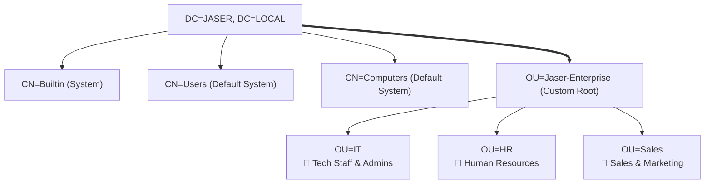

# Day 03: Organizational Unit (OU) Hierarchy & User Management

[](../README.md)
[](../README.md)
[](../README.md)

---

## 🎯 3.1 Objective
The objective of Day 03 is to design and implement a structured, scalable Active Directory logical hierarchy. By segregating users and computers into Organizational Units (OUs), we establish administrative boundaries that enable targeted Group Policy application and granular delegation of administration.

---

## 🔬 3.2 Enterprise Architecture & "The Small Things"

### 1. Custom OUs vs Default System Containers (`CN=Users`)
- **The Core Problem with Default Containers**: Out of the box, Active Directory places newly created users in `CN=Users,DC=JASER,DC=LOCAL` and computers in `CN=Computers,DC=JASER,DC=LOCAL`. In LDAP terminology, `CN` indicates a **Common Name container**, whereas `OU` indicates an **Organizational Unit**.
- **Crucial Limitation**: **Group Policy Objects (GPOs) cannot be linked directly to `CN` containers.** 
- **The Architecture Fix**: Create a dedicated top-level root OU (`Jaser-Enterprise`) to isolate enterprise assets from built-in system objects, enabling structured GPO inheritance.



### 2. Departmental Segmentation
To mirror real-world business units and support distinct security postures:
- **`OU=IT`**: Houses technical staff with administrative tool requirements.
- **`OU=HR`**: Houses human resources personnel handling sensitive PII data requiring strict screen locking and restricted settings access.
- **`OU=Sales`**: Houses commercial staff requiring desktop interface standardization and execution restrictions.

### 3. User Principal Names (UPN) vs Down-Level Logon
- **UPN format**: `jaser.halabi@jaser.local` (modern, email-like format used by modern Kerberos/SAML/Azure AD Connect).
- **Down-Level / Pre-Windows 2000 format**: `JASER\jhalabi` (sAMAccountName used by legacy NTLM applications).
- **Accidental Deletion Protection**: Applying the `ProtectFromAccidentalDeletion` flag modifies object access control entries (ACEs) to deny `Delete` and `Delete Subtree` permissions to `Everyone`.

---

## 🛠️ 3.3 Implementation Steps

### Method 1: Graphical User Interface (GUI)
1. **Root OU Creation**:
   - Open **Active Directory Users and Computers** (`dsa.msc`).
   - Right-click the domain node `JASER.LOCAL` > Select **New** > **Organizational Unit**.
   - Name: `Jaser-Enterprise`. Ensure **Protect container from accidental deletion** is checked.
2. **Sub-OU Creation**:
   - Right-click `Jaser-Enterprise` > Select **New** > **Organizational Unit**.
   - Create three departmental sub-OUs: `IT`, `Sales`, and `HR`.
3. **User Account Provisioning (IT Department)**:
   - Navigate to `JASER.LOCAL` > `Jaser-Enterprise` > `IT`.
   - Right-click inside the container > Select **New** > **User**.
   - **User 1**:
     - First Name: `Jaser`, Last Name: `Al. Halabi`
     - User Logon Name: `jhalabi` (UPN: `jhalabi@jaser.local`)
     - Set secure password and configure appropriate password flags.
   - **User 2**:
     - First Name: `Reem`, Last Name: `Abu. Shamma`
     - User Logon Name: `rshamma` (UPN: `rshamma@jaser.local`)
     - Set secure password.

---

## ⚡ 3.4 Automated PowerShell Deployment

```powershell
<#
.SYNOPSIS
    Day 03 - Automated Enterprise OU Hierarchy & User Account Provisioning.
.DESCRIPTION
    Creates the Jaser-Enterprise root OU, departmental sub-OUs, and provisions initial IT users.
#>

Import-Module ActiveDirectory

Write-Host "[+] Initializing Day 03 OU Structure & User Provisioning..." -ForegroundColor Cyan

# 1. Root OU Provisioning
$RootOUPath = "DC=JASER,DC=LOCAL"
$RootOUName = "Jaser-Enterprise"
$FullRootOU = "OU=$RootOUName,$RootOUPath"

if (-not (Get-ADOrganizationalUnit -Filter "Name -eq '$RootOUName'" -ErrorAction SilentlyContinue)) {
    Write-Host "[*] Creating Root OU: $RootOUName..." -ForegroundColor Yellow
    New-ADOrganizationalUnit -Name $RootOUName -Path $RootOUPath -ProtectedFromAccidentalDeletion $true
}

# 2. Departmental Sub-OUs
$Departments = @("IT", "Sales", "HR")
foreach ($Dept in $Departments) {
    if (-not (Get-ADOrganizationalUnit -Filter "Name -eq '$Dept'" -SearchBase $FullRootOU -ErrorAction SilentlyContinue)) {
        Write-Host "[*] Creating Departmental OU: $Dept..." -ForegroundColor Yellow
        New-ADOrganizationalUnit -Name $Dept -Path $FullRootOU -ProtectedFromAccidentalDeletion $true
    }
}

# 3. User Account Provisioning in IT OU
$ITPath = "OU=IT,$FullRootOU"
$Users = @(
    @{
        FirstName   = "Jaser"
        LastName    = "Al. Halabi"
        DisplayName = "Jaser Al. Halabi"
        SamAccount  = "jhalabi"
        UPN         = "jhalabi@jaser.local"
    },
    @{
        FirstName   = "Reem"
        LastName    = "Abu. Shamma"
        DisplayName = "Reem Abu. Shamma"
        SamAccount  = "rshamma"
        UPN         = "rshamma@jaser.local"
    }
)

$SecurePassword = ConvertTo-SecureString "EnterpriseSecure2026!" -AsPlainText -Force

foreach ($U in $Users) {
    if (-not (Get-ADUser -Filter "SamAccountName -eq '$($U.SamAccount)'" -ErrorAction SilentlyContinue)) {
        Write-Host "[*] Provisioning User: $($U.DisplayName)..." -ForegroundColor Yellow
        New-ADUser `
            -Name $U.DisplayName `
            -GivenName $U.FirstName `
            -Surname $U.LastName `
            -DisplayName $U.DisplayName `
            -SamAccountName $U.SamAccount `
            -UserPrincipalName $U.UPN `
            -Path $ITPath `
            -AccountPassword $SecurePassword `
            -Enabled $true `
            -PasswordNeverExpires $false `
            -ChangePasswordAtLogon $false
        Write-Host "[+] User $($U.SamAccount) created in $ITPath" -ForegroundColor Green
    }
}
```

---

## 🔍 3.5 Verification & Evidence

### Verification Commands
```powershell
# Verify OU Tree Structure
Get-ADOrganizationalUnit -Filter * -SearchBase "OU=Jaser-Enterprise,DC=JASER,DC=LOCAL" | Select-Object Name, DistinguishedName

# Verify Provisioned User Accounts in IT OU
Get-ADUser -Filter * -SearchBase "OU=IT,OU=Jaser-Enterprise,DC=JASER,DC=LOCAL" -Properties DisplayName, UserPrincipalName, Enabled | Select-Object Name, SamAccountName, UserPrincipalName, Enabled
```

### Expected Output
```text
Name             DistinguishedName
----             -----------------
Jaser-Enterprise OU=Jaser-Enterprise,DC=JASER,DC=LOCAL
IT               OU=IT,OU=Jaser-Enterprise,DC=JASER,DC=LOCAL
Sales            OU=Sales,OU=Jaser-Enterprise,DC=JASER,DC=LOCAL
HR               OU=HR,OU=Jaser-Enterprise,DC=JASER,DC=LOCAL

Name               SamAccountName UserPrincipalName    Enabled
----               -------------- -----------------    -------
Jaser Al. Halabi   jhalabi        jhalabi@jaser.local  True
Reem Abu. Shamma   rshamma        rshamma@jaser.local  True
```

---

## 📌 3.6 Key Takeaways & Sysadmin Insights
- **Scalability**: By organizing departments beneath `Jaser-Enterprise`, broad company-wide policies can be linked at the root OU level, while granular departmental policies can be linked to the sub-OUs without GPO link bloat at the domain head.
- **Accidental Deletion Protection**: Keeps production AD trees safe from errant bulk PowerShell deletions or accidental GUI drag-and-drop actions.
