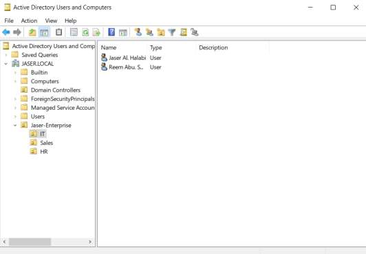

# Day 03: Organizational Unit (OU) & User Management

---

## 🎯 3.1 Objective
The objective of this phase is to design a logical hierarchy that reflects a corporate structure, allowing for granular management of users, computers, and Group Policy Objects (GPOs).

---

## 🛠️ 3.2 What I Did (Implementation Steps)

1. **Root OU Creation**:
   - Opened **Active Directory Users and Computers** (`dsa.msc`).
   - Established a top-level OU titled **`Jaser-Enterprise`** directly beneath `JASER.LOCAL` to separate corporate objects from default system containers.
   
2. **Departmental Segmentation**:
   - Created three departmental sub-OUs beneath `Jaser-Enterprise`:
     - **`IT`** (Information Technology)
     - **`Sales`** (Sales Department)
     - **`HR`** (Human Resources)

3. **User Provisioning**:
   - Populated the `IT` OU with initial user accounts applying enterprise naming conventions and security protocols:
     - **`Jaser Al. Halabi`** (User)
     - **`Reem Abu. Shamma`** (User)

---

## 🧠 3.3 "The Small Things": Technical Rationale & Sysadmin Details

- **Why I created a custom Root OU instead of using `CN=Users`**:
  Default Active Directory containers like `CN=Users` and `CN=Computers` are standard Common Name containers. **Group Policy Objects cannot be directly linked to `CN` containers.** By creating the `Jaser-Enterprise` OU, I established an administrative root where Group Policy can be linked and inherited cleanly.
- **Departmental Sub-OUs**:
  Creating distinct OUs for `IT`, `Sales`, and `HR` allows me to apply different security policies (GPOs) to different teams (e.g. strict screen locking for HR, administrative tools for IT) rather than applying blanket policies to the entire company.
- **Enterprise Naming & Security Conventions**:
  Each account was created with standardized User Principal Names (`user@jaser.local`), strong password requirements, and accidental deletion protection enabled on the containers.

---

## 📸 3.4 Visual Evidence & UI Verification

Below is the verification screenshot from my lab report showing the completed OU hierarchy and provisioned user accounts:

### Breakdown of the Verification Screenshot:
- **Navigation Tree (Left Pane)**:
  - Shows the domain root **`JASER.LOCAL`** alongside default containers (`Builtin`, `Computers`, `Domain Controllers`, `ForeignSecurityPrincipals`, `Managed Service Accounts`, `Users`).
  - Shows the custom root OU **`Jaser-Enterprise`**.
  - Shows the expanded departmental sub-OUs: **`IT`** (selected), **`Sales`**, and **`HR`**.
- **Object Window (Right Pane)**:
  - Confirms the provisioned accounts inside the `IT` OU:
    - **`Jaser Al. Halabi`** | Type: `User`
    - **`Reem Abu. Shamma`** | Type: `User`

---

## 📋 3.5 Verification Summary

| Organizational Unit | Parent Container | Purpose | Provisioned Objects |
| :--- | :--- | :--- | :--- |
| **`Jaser-Enterprise`** | `DC=JASER,DC=LOCAL` | Enterprise Root OU | Sub-OUs: IT, Sales, HR |
| **`IT`** | `OU=Jaser-Enterprise` | IT Department & Admins | `Jaser Al. Halabi`, `Reem Abu. Shamma` |
| **`Sales`** | `OU=Jaser-Enterprise` | Commercial Staff | Departmental Container |
| **`HR`** | `OU=Jaser-Enterprise` | Human Resources & PII | Departmental Container |
