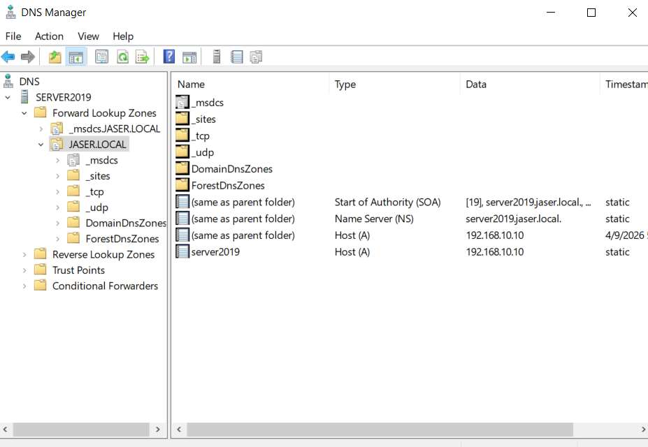

# Day 04: DNS Management

---

## 🎯 4.1 Objective
To verify the automated installation and health of the **Domain Name System (DNS)**. In an AD DS environment, DNS is required for service discovery and name-to-IP resolution.

---

## 🛠️ 4.2 Implementation Steps

- **Service Verification**: Confirmed that the DNS Server role was successfully initialized alongside Active Directory.
- **Zone Management**: Verified the existence of the Forward Lookup Zone for **`JASER.LOCAL`**.
- **Record Validation**: Confirmed that the primary Host (A) record is correctly mapped to the server’s static IP (**`192.168.10.10`**).

---

## 📸 4.3 Visual Evidence & Verification

### Verification Details from DNS Manager:
- **Left Console Tree**:
  - Authoritative DNS Server: `SERVER2019`.
  - Forward Lookup Zones: `_msdcs.JASER.LOCAL` and `JASER.LOCAL`.
  - Service containers: `_msdcs`, `_sites`, `_tcp`, `_udp`, `DomainDnsZones`, `ForestDnsZones`.
- **Right Records Grid**:
  - **Start of Authority (SOA)**: `[19], server2019.jaser.local.`
  - **Name Server (NS)**: `server2019.jaser.local.`
  - **Host (A) `(same as parent folder)`**: `192.168.10.10`
  - **Host (A) `server2019`**: `192.168.10.10`

---

## 📋 4.4 Configuration Summary

| Record Name | Record Type | Data | Verification Status |
| :--- | :--- | :--- | :---: |
| `(same as parent folder)` | Start of Authority (SOA) | `[19], server2019.jaser.local.` | ✅ Verified |
| `(same as parent folder)` | Name Server (NS) | `server2019.jaser.local.` | ✅ Verified |
| `(same as parent folder)` | Host (A) | `192.168.10.10` | ✅ Verified |
| `server2019` | Host (A) | `192.168.10.10` | ✅ Verified |
