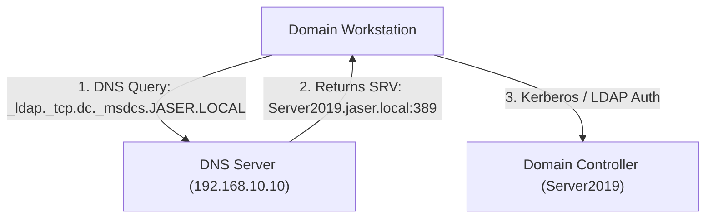

# Day 04: DNS Management & Active Directory Service Discovery

[](../README.md)
[](../README.md)
[](../README.md)

---

## 🎯 4.1 Objective
The objective of Day 04 is to audit, configure, and validate the health of the **Domain Name System (DNS)** server role. In an Active Directory environment, DNS is not merely a name-to-IP resolution service—it is the foundational locator mechanism through which domain members discover Domain Controllers, Global Catalogs, and Kerberos Key Distribution Centers (KDCs).

---

## 🔬 4.2 Enterprise Architecture & "The Small Things"

### 1. Active Directory-Integrated Zones
Unlike standard file-backed DNS zones (`.dns` flat files in `%SystemRoot%\System32\Dns`), **Active Directory-Integrated Zones** store DNS records directly within the `DomainDnsZones` and `ForestDnsZones` application directory partitions:
- **Multi-Master Replication**: Any Domain Controller running DNS can accept read/write updates, which are replicated across the domain via directory replication.
- **Secure Dynamic Updates**: Updates are restricted strictly to authenticated Active Directory domain members (using GSS-TSIG and Kerberos authentication), mitigating DNS cache poisoning and malicious spoofed record registrations.

### 2. The `_msdcs` Subdomain & SRV Service Records
The `_msdcs.JASER.LOCAL` zone contains essential Service (SRV) locator records:
- **`_ldap._tcp.dc._msdcs.JASER.LOCAL`**: Allows clients to find Domain Controllers running LDAP services on port 389.
- **`_kerberos._tcp.dc._msdcs.JASER.LOCAL`**: Allows clients to locate the Kerberos KDC on port 88.
- **`_kpasswd._tcp`**: Handles Kerberos password changes on port 464.
- **GUID-based CNAMEs**: Enables replication partners to locate each other even if their hostnames change.



### 3. Record Audit Checklist
- **Start of Authority (SOA)**: Defines zone authority, primary server (`server2019.jaser.local`), contact info, and refresh/retry intervals.
- **Name Server (NS)**: Points to authoritative DNS servers (`server2019.jaser.local`).
- **Primary Host (A) Record**: Binds the domain controller's hostname (`Server2019`) and parent domain apex (`(same as parent folder)`) to `192.168.10.10`.

---

## 🛠️ 4.3 Implementation Steps

### Method 1: Graphical User Interface (GUI)
1. **Service Verification**:
   - Open **DNS Manager** (`dnsmgmt.msc`).
   - Expand `SERVER2019` > **Forward Lookup Zones**.
2. **Zone Management**:
   - Verify the existence of the primary AD-integrated zone: `JASER.LOCAL`.
   - Verify the `_msdcs.JASER.LOCAL` delegation/sub-zone.
3. **Record Validation**:
   - Inside `JASER.LOCAL`, verify that:
     - The **Start of Authority (SOA)** record resolves to `[19], server2019.jaser.local.`.
     - The **Name Server (NS)** record lists `server2019.jaser.local.`.
     - The **Host (A)** record for `server2019` points to `192.168.10.10`.
     - The `(same as parent folder)` Host (A) record points to `192.168.10.10`.

---

## ⚡ 4.4 Automated PowerShell Deployment & Validation

```powershell
<#
.SYNOPSIS
    Day 04 - Automated DNS Zone Audit and Record Health Validation.
.DESCRIPTION
    Validates Forward Lookup Zones, verifies SRV records, and confirms Host (A) bindings.
#>

Import-Module DnsServer

Write-Host "[+] Initializing Day 04 DNS Audit & Validation..." -ForegroundColor Cyan

# 1. Audit DNS Zones
$ZoneName = "JASER.LOCAL"
Write-Host "[*] Auditing DNS Forward Lookup Zone: $ZoneName..." -ForegroundColor Yellow

$Zone = Get-DnsServerZone -Name $ZoneName -ErrorAction SilentlyContinue
if ($Zone) {
    Write-Host "[+] Zone '$ZoneName' found (Type: $($Zone.ZoneType), Replication: $($Zone.ReplicationScope))." -ForegroundColor Green
} else {
    Write-Error "[-] Zone '$ZoneName' is missing!"
}

# 2. Validate Host (A) Records
Write-Host "[*] Validating Host (A) records..." -ForegroundColor Yellow
$ARecords = Get-DnsServerResourceRecord -ZoneName $ZoneName -RRType A
foreach ($Record in $ARecords) {
    Write-Host "    - Host: $($Record.HostName) -> IP: $($Record.RecordData.IPv4Address.IPAddressToString)" -ForegroundColor Cyan
}

# 3. Validate AD DS SRV Locator Records
Write-Host "[*] Auditing Kerberos and LDAP SRV Locator Records..." -ForegroundColor Yellow
$SRVRecords = Get-DnsServerResourceRecord -ZoneName $ZoneName -RRType SRV
foreach ($SRV in $SRVRecords) {
    Write-Host "    - SRV: $($SRV.HostName) -> Target: $($SRV.RecordData.MailExchange):$($SRV.RecordData.PortNumber)" -ForegroundColor Cyan
}

# 4. Perform Loopback & Remote Name Resolution Tests
Write-Host "[*] Testing Name Resolution for Domain Apex and DC..." -ForegroundColor Yellow
$ApexTest = Resolve-DnsName -Name $ZoneName -Server 127.0.0.1 -Type A
$HostTest = Resolve-DnsName -Name "Server2019.$ZoneName" -Server 127.0.0.1 -Type A

Write-Host "[+] Apex '$ZoneName' resolves to: $($ApexTest.IPAddress)" -ForegroundColor Green
Write-Host "[+] Host 'Server2019.$ZoneName' resolves to: $($HostTest.IPAddress)" -ForegroundColor Green
```

---

## 🔍 4.5 Verification & Evidence

### Verification Commands
```powershell
# Query SOA and NS Records
Get-DnsServerResourceRecord -ZoneName "JASER.LOCAL" | Where-Object { $_.RecordType -in @("SOA", "NS", "A") } | Select-Object HostName, RecordType, RecordData

# Test DNS Server Health
Test-DnsServer -IPAddress 192.168.10.10 -Context DnsServers
```

### Expected Output
```text
HostName               RecordType RecordData
--------               ---------- ----------
@                      SOA        DnsServerResourceRecordSoa
@                      NS         DnsServerResourceRecordNs
@                      A          DnsServerResourceRecordA (192.168.10.10)
server2019             A          DnsServerResourceRecordA (192.168.10.10)
```

---

## 📌 4.6 Key Takeaways & Sysadmin Insights
- **Apex Resolution**: The `@` record (same as parent folder) ensures that queries directed at `jaser.local` resolve directly to the Domain Controller IP `192.168.10.10`.
- **Dynamic Updates**: AD-integrated zones enforce Kerberos-authenticated dynamic updates, preventing rogue machines from overwriting critical server records.
