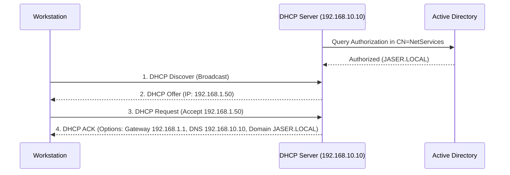

# Day 05: DHCP Automation & Enterprise Scope Architecture

[](../README.md)
[](../README.md)
[](../README.md)

---

## 🎯 5.1 Objective
The objective of Day 05 is to install the **Dynamic Host Configuration Protocol (DHCP)** server role, authorize it within Active Directory, and configure a dedicated IPv4 distribution scope with standardized enterprise options. This eliminates manual workstation IP provisioning while guaranteeing uniform DNS and gateway settings across domain clients.

---

## 🔬 5.2 Enterprise Architecture & "The Small Things"

### 1. Active Directory Authorization & Rogue DHCP Prevention
- **The Security Risk**: A rogue or misconfigured DHCP server on a corporate network can distribute invalid gateway/DNS addresses, leading to widespread denial of service or Man-in-the-Middle (MitM) attacks.
- **The Windows Server Defense Mechanism**: In an Active Directory domain, a Windows DHCP Server queries Active Directory before servicing client requests. If the server's IP/hostname is not explicitly registered in the directory's Authorized DHCP Servers list (`CN=NetServices,CN=Services,CN=Configuration,DC=JASER,DC=LOCAL`), the DHCP service **shuts down its listener socket** and logs an error in the Event Viewer (`Event ID 1046`).
- **Required Action**: Authorize the DHCP server using `Add-DhcpServerInDC`.

### 2. Standard Enterprise DHCP Options Breakdown

| Option Code | Option Name | Value Assigned | Technical Function & Impact |
| :--- | :--- | :--- | :--- |
| **003** | **Router (Default Gateway)** | `192.168.1.1` | Directs client outbound traffic destined for remote subnets/WAN to the core edge router. |
| **006** | **DNS Servers** | `192.168.10.10` | Enforces that all client DNS lookups query the Domain Controller, enabling AD service resolution and domain joins. |
| **015** | **DNS Domain Name** | `JASER.LOCAL` | Appends the connection-specific DNS suffix to short/NetBIOS queries (e.g. `ping fileserver` automatically expands to `ping fileserver.jaser.local`). |

### 3. The DORA Lifecycle & Option Hierarchy
- **DORA Exchange**: Discover (Broadcast) -> Offer (Unicast/Broadcast) -> Request (Broadcast) -> Acknowledge (Unicast).
- **Scope Options vs Server Options**: Scope Options apply strictly to clients receiving leases from a specific subnet, overriding global Server Options.



---

## 🛠️ 5.3 Implementation Steps

### Method 1: Graphical User Interface (GUI)
1. **Role Installation & Post-Install Authorization**:
   - Open **Server Manager** > **Add Roles and Features**.
   - Select **DHCP Server** role > complete installation.
   - Click the Notification flag > Select **Complete DHCP configuration**.
   - Authorize using Domain Administrator credentials (`JASER\Administrator`).
2. **Scope Provisioning**:
   - Open **DHCP Management Console** (`dhcpmgmt.msc`).
   - Expand `server2019.jaser.local` > Right-click **IPv4** > Select **New Scope...**.
   - Scope Name: `Enterprise Client Scope`.
   - IP Range: Start `192.168.1.100` to End `192.168.1.200`, Subnet Mask: `255.255.255.0`.
3. **Option Configuration**:
   - In the **Configure DHCP Options** wizard:
     - Option 003 (Router): Enter `192.168.1.1` > Click **Add**.
     - Option 006 (DNS Servers): Enter `192.168.10.10` > Click **Add**.
     - Option 015 (DNS Domain Name): Enter `JASER.LOCAL`.
   - Activate the scope immediately.

---

## ⚡ 5.4 Automated PowerShell Deployment

```powershell
<#
.SYNOPSIS
    Day 05 - Automated DHCP Server Installation, AD Authorization, and Scope Setup.
.DESCRIPTION
    Installs DHCP role, authorizes in Active Directory, creates IPv4 scope, and applies Options 003, 006, and 015.
#>

Write-Host "[+] Initializing Day 05 DHCP Deployment & Scope Automation..." -ForegroundColor Cyan

# 1. Install DHCP Role & Management Tools
Write-Host "[*] Installing DHCP Server role..." -ForegroundColor Yellow
Install-WindowsFeature -Name DHCP -IncludeManagementTools

# 2. Authorize DHCP Server in Active Directory
$DnsName = "server2019.jaser.local"
$ServerIP = "192.168.10.10"

Write-Host "[*] Authorizing DHCP Server ($DnsName - $ServerIP) in Active Directory..." -ForegroundColor Yellow
Add-DhcpServerInDC -DnsName $DnsName -IPAddress $ServerIP

# 3. Create IPv4 Scope
$ScopeId = "192.168.1.0"
$StartRange = "192.168.1.100"
$EndRange = "192.168.1.200"
$SubnetMask = "255.255.255.0"
$ScopeName = "Enterprise Client Scope"

Write-Host "[*] Creating Scope $ScopeName ($ScopeId)..." -ForegroundColor Yellow
Add-DhcpServerv4Scope `
    -Name $ScopeName `
    -StartRange $StartRange `
    -EndRange $EndRange `
    -SubnetMask $SubnetMask `
    -State Active

# 4. Set Scope Options (003, 006, 015)
Write-Host "[*] Applying Scope Options (003 Router, 006 DNS, 015 Domain Name)..." -ForegroundColor Yellow

Set-DhcpServerv4OptionValue `
    -ScopeId $ScopeId `
    -OptionId 3 `
    -Value "192.168.1.1"

Set-DhcpServerv4OptionValue `
    -ScopeId $ScopeId `
    -OptionId 6 `
    -Value $ServerIP

Set-DhcpServerv4OptionValue `
    -ScopeId $ScopeId `
    -OptionId 15 `
    -Value "JASER.LOCAL"

Write-Host "[+] DHCP Scope and Options successfully provisioned and activated." -ForegroundColor Green
```

---

## 🔍 5.5 Verification & Evidence

### Verification Commands
```powershell
# Verify AD Authorization
Get-DhcpServerInDC

# Verify Scope Status
Get-DhcpServerv4Scope

# Verify Configured Scope Options
Get-DhcpServerv4OptionValue -ScopeId "192.168.1.0" | Select-Object OptionId, Name, Value
```

### Expected Output
```text
IPAddress     DnsName
---------     -------
192.168.10.10 server2019.jaser.local

ScopeId       SubnetMask      Name                    State    StartRange    EndRange
-------       ----------      ----                    -----    ----------    --------
192.168.1.0   255.255.255.0   Enterprise Client Scope Active   192.168.1.100 192.168.1.200

OptionId Name            Value
-------- ----            -----
3        Router          {192.168.1.1}
6        DNS Servers     {192.168.10.10}
15       DNS Domain Name {JASER.LOCAL}
```

---

## 📌 5.6 Key Takeaways & Sysadmin Insights
- **Lease Reliability**: Configuring Option 006 with `192.168.10.10` guarantees that dynamically addressed endpoints automatically inherit the correct domain-aware DNS server without client-side manual intervention.
- **Authorization Enforcement**: If authorization is omitted, the `DhcpSubnet` and `DhcpServer` service state enters an error condition on domain networks.
