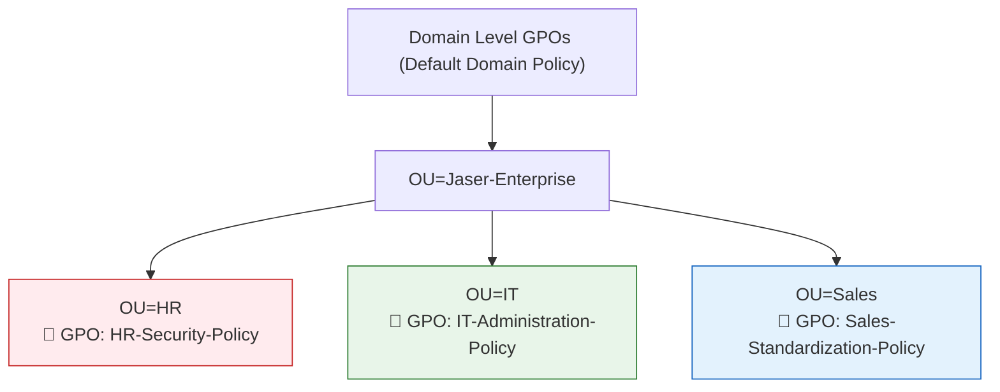

# Day 06: Departmental Group Policy Objects (GPO) & Security Hardening

[](../README.md)
[](../README.md)
[](../README.md)

---

## 🎯 6.1 Objective
The objective of Day 06 is to implement role-based, departmental Group Policy Objects (GPOs). Rather than enforcing blanket policies across the entire domain, targeted Administrative Template baselines are linked to the **HR**, **IT**, and **Sales** Organizational Units to enforce the **Principle of Least Privilege**, reduce the physical and digital attack surface, and standardize client workstation behavior.

---

## 🔬 6.2 Enterprise Architecture & "The Small Things"

### 1. The LSDOU Precedence Engine
Windows Group Policy processes policies in a strict sequential order:
$$\text{Local} \longrightarrow \text{Site} \longrightarrow \text{Domain} \longrightarrow \text{Organizational Unit (OU)}$$
- **Precedence Rule**: "Last writer wins." Settings applied at the OU level take precedence over and override conflicting settings defined at the Domain or Site level.
- **Granularity**: By linking custom GPOs directly to `OU=HR`, `OU=IT`, and `OU=Sales`, departmental settings apply strictly to target users without impacting domain-wide administrative operations.



### 2. Departmental Policy Rationale & Technical Paths

#### A. Human Resources (`OU=HR`) — High Security & PII Protection
*HR personnel regularly handle Personally Identifiable Information (PII), payroll, and employee records.*
- **Policy 1: Force Screen Saver Password**
  - **Path**: `User Configuration > Policies > Administrative Templates > Control Panel > Personalization > Password protect the screen saver` (`Enabled`)
  - **Security Rationale**: Prevents physical shoulder-surfing and unauthorized session hijacking when staff step away from unattended terminals.
- **Policy 2: Prohibit Access to Control Panel & PC Settings**
  - **Path**: `User Configuration > Policies > Administrative Templates > Control Panel > Prohibit access to Control Panel and PC settings` (`Enabled`)
  - **Security Rationale**: Restricts standard users from altering network adapters, uninstalling software, or modifying security settings.

#### B. Information Technology (`OU=IT`) — Operational Flexibility
*IT administrators and support engineers require deep system access to troubleshoot and manage infrastructure.*
- **Policy 1: Allow Command Prompt**
  - **Path**: `User Configuration > Policies > Administrative Templates > System > Prevent access to the command prompt` (`Disabled`)
  - **Rationale**: Explicitly ensures command line (`cmd.exe`) and scripting environments remain accessible for IT staff without policy conflicts.
- **Policy 2: Disable Lock Screen**
  - **Path**: `User Configuration > Policies > Administrative Templates > Control Panel > Personalization > Do not display the lock screen` (`Enabled`)
  - **Rationale**: Streamlines technician workstation login flows by bypassing the informational lock screen overlay directly to the credential prompt.

#### C. Sales Department (`OU=Sales`) — Environment Standardization
*Commercial workstations require visual standardization and restriction of unauthorized execution vectors.*
- **Policy 1: Prevent Changing Desktop Background**
  - **Path**: `User Configuration > Policies > Administrative Templates > Control Panel > Personalization > Prevent changing desktop background` (`Enabled`)
  - **Rationale**: Enforces uniform corporate branding and prevents the display of inappropriate or unauthorized imagery.
- **Policy 2: Remove "Run" Command from Start Menu**
  - **Path**: `User Configuration > Policies > Administrative Templates > Start Menu and Taskbar > Remove Run menu from Start Menu` (`Enabled`)
  - **Rationale**: Eliminates quick access to the Windows Run dialog (`Win+R`), mitigating casual execution of unauthorized binaries or CLI tools.

---

## 🛠️ 6.3 Implementation Steps

### Method 1: Graphical User Interface (GUI)
1. **Open Group Policy Management Console**:
   - Open **Group Policy Management** (`gpmc.msc`).
   - Expand `Forest: JASER.LOCAL` > `Domains` > `JASER.LOCAL` > `Jaser-Enterprise`.
2. **Configure HR Security GPOs**:
   - Right-click `OU=HR` > Select **Create a GPO in this domain, and Link it here...**.
   - Create GPO: `HR-Security-Policy`.
   - Right-click > **Edit** > Navigate to paths and enable:
     - `Password protect the screen saver`
     - `Prohibit access to Control Panel and PC settings`
3. **Configure IT Administration GPOs**:
   - Right-click `OU=IT` > Link new GPO: `IT-Administration-Policy`.
   - Edit and configure:
     - `Prevent access to the command prompt` -> **Disabled**
     - `Do not display the lock screen` -> **Enabled**
4. **Configure Sales Standardization GPOs**:
   - Right-click `OU=Sales` > Link new GPO: `Sales-Standardization-Policy`.
   - Edit and configure:
     - `Prevent changing desktop background` -> **Enabled**
     - `Remove Run menu from Start Menu` -> **Enabled**

---

## ⚡ 6.4 Automated PowerShell Deployment

```powershell
<#
.SYNOPSIS
    Day 06 - Automated Departmental GPO Creation, Policy Setting, and Link Provisioning.
.DESCRIPTION
    Creates targeted GPOs for HR, IT, and Sales, configures registry-based policy settings, and links to sub-OUs.
#>

Import-Module GroupPolicy

Write-Host "[+] Initializing Day 06 Group Policy Hardening Automation..." -ForegroundColor Cyan

$Domain = "JASER.LOCAL"
$BaseOU = "OU=Jaser-Enterprise,DC=JASER,DC=LOCAL"

# Helper Function to Create and Link GPOs
function New-LinkedGPO {
    param ([string]$GpoName, [string]$TargetOUPath)
    
    $GPO = Get-GPO -Name $GpoName -ErrorAction SilentlyContinue
    if (-not $GPO) {
        Write-Host "[*] Creating GPO: $GpoName..." -ForegroundColor Yellow
        $GPO = New-GPO -Name $GpoName -Comment "Automated Departmental Security Baseline"
    }
    
    Write-Host "[*] Linking $GpoName to $TargetOUPath..." -ForegroundColor Yellow
    New-GPLink -Name $GpoName -Target $TargetOUPath -ErrorAction SilentlyContinue
    return $GPO
}

# 1. HR Security GPO
$HRGPO = New-LinkedGPO -GpoName "HR-Security-Policy" -TargetOUPath "OU=HR,$BaseOU"
# Password Protect Screen Saver
Set-GPRegistryValue -Name "HR-Security-Policy" -Key "HKCU\Software\Policies\Microsoft\Windows\Control Panel\Desktop" -ValueName "ScreenSaverIsSecure" -Type String -Value "1"
# Prohibit Control Panel
Set-GPRegistryValue -Name "HR-Security-Policy" -Key "HKCU\Software\Microsoft\Windows\CurrentVersion\Policies\Explorer" -ValueName "NoControlPanel" -Type DWord -Value 1

# 2. IT Administration GPO
$ITGPO = New-LinkedGPO -GpoName "IT-Administration-Policy" -TargetOUPath "OU=IT,$BaseOU"
# Allow Command Prompt (Disabled restriction = 0)
Set-GPRegistryValue -Name "IT-Administration-Policy" -Key "HKCU\Software\Policies\Microsoft\Windows\System" -ValueName "DisableCMD" -Type DWord -Value 0
# Do Not Display Lock Screen
Set-GPRegistryValue -Name "IT-Administration-Policy" -Key "HKLM\SOFTWARE\Policies\Microsoft\Windows\Personalization" -ValueName "NoLockScreen" -Type DWord -Value 1

# 3. Sales Standardization GPO
$SalesGPO = New-LinkedGPO -GpoName "Sales-Standardization-Policy" -TargetOUPath "OU=Sales,$BaseOU"
# Prevent Changing Wallpaper
Set-GPRegistryValue -Name "Sales-Standardization-Policy" -Key "HKCU\Software\Microsoft\Windows\CurrentVersion\Policies\ActiveDesktop" -ValueName "NoChangingWallPaper" -Type DWord -Value 1
# Remove Run Command
Set-GPRegistryValue -Name "Sales-Standardization-Policy" -Key "HKCU\Software\Microsoft\Windows\CurrentVersion\Policies\Explorer" -ValueName "NoRun" -Type DWord -Value 1

Write-Host "[+] All departmental GPOs created, configured, and linked." -ForegroundColor Green
```

---

## 🔍 6.5 Verification & Evidence

### Verification Commands
```powershell
# List Linked GPOs for each OU
Get-GPInheritance -Target "OU=HR,OU=Jaser-Enterprise,DC=JASER,DC=LOCAL" | Select-Object -ExpandProperty InheritedGpoLinks
Get-GPInheritance -Target "OU=IT,OU=Jaser-Enterprise,DC=JASER,DC=LOCAL" | Select-Object -ExpandProperty InheritedGpoLinks
Get-GPInheritance -Target "OU=Sales,OU=Jaser-Enterprise,DC=JASER,DC=LOCAL" | Select-Object -ExpandProperty InheritedGpoLinks

# Generate RSoP Report (from client session)
gpresult /r
# Output detailed HTML report:
# gpresult /h C:\GPO_Report.html
```

### Expected Output
```text
GpoName                    DisplayName                Enabled Order
-------                    -----------                ------- -----
HR-Security-Policy         HR-Security-Policy         True    1
Default Domain Policy      Default Domain Policy      True    2

GpoName                    DisplayName                Enabled Order
-------                    -----------                ------- -----
IT-Administration-Policy   IT-Administration-Policy   True    1
Default Domain Policy      Default Domain Policy      True    2

GpoName                    DisplayName                Enabled Order
-------                    -----------                ------- -----
Sales-Standardization-Policy Sales-Standardization-Policy True 1
Default Domain Policy      Default Domain Policy      True    2
```

---

## 📌 6.6 Key Takeaways & Sysadmin Insights
- **GPO Refresh Interval**: Windows background refresh runs every 90 minutes with a random 0–30 minute offset. For instant testing on client machines, execute `gpupdate /force`.
- **Registry Mechanics**: User Configuration Administrative Templates modify the `HKCU\Software\Policies` and `HKCU\Software\Microsoft\Windows\CurrentVersion\Policies` registry keys, ensuring non-admin users cannot undo policy settings via `regedit`.
