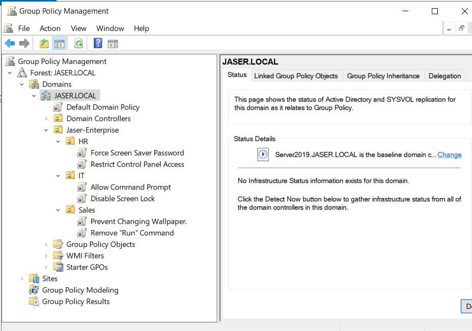

# Day 06: Departmental Group Policy Implementation & Security Hardening

[](../README.md)
[](../README.md)
[](../README.md)

---

## 🎯 6.1 Objective
The objective of this phase is setting up Group Policy Objects (GPOs) to make sure each department has the right level of access. Instead of having the same rules for everyone, the **`HR`**, **`IT`**, and **`Sales`** OUs are used to apply specific restrictions. This ensures users only get the tools they actually need for their jobs and keeps the server environment secure by locking down things they shouldn't be touching.

---

## 🔬 6.2 Implementation Details & Technical Paths

### 1. (HR) Security Baseline
*Enforces confidentiality and prevents physical shoulder-surfing of sensitive human resources and PII data.*
- **Force Screen Saver Password**:
  - **Path**: `User Configuration > Policies > Administrative Templates > Control Panel > Personalization > Password protect the screen saver`
- **Restrict Control Panel Access**:
  - **Path**: `User Configuration > Policies > Administrative Templates > Control Panel > Prohibit access to Control Panel and PC settings`

### 2. (IT) Administration Baseline
*Provides administrative tools for technical staff while streamlining administrative workstation sign-ins.*
- **Allow Command Prompt**:
  - **Path**: `User Configuration > Policies > Administrative Templates > System > Prevent access to the command prompt` *(Set to Disabled)*
- **Disable Screen Lock**:
  - **Path**: `User Configuration > Policies > Administrative Templates > Control Panel > Personalization > Do not display the lock screen`

### 3. Sales Department Standardization
*Standardizes the user desktop environment and eliminates unauthorized execution vectors.*
- **Prevent Changing Wallpaper**:
  - **Path**: `User Configuration > Policies > Administrative Templates > Control Panel > Personalization > Prevent changing desktop background`
- **Remove "Run" Command**:
  - **Path**: `User Configuration > Policies > Administrative Templates > Start Menu and Taskbar > Remove Run menu from Start Menu`

---

## 🛠️ 6.3 Implementation Steps

1. Open **Group Policy Management** (`gpmc.msc`).
2. Expand `Forest: JASER.LOCAL` > `Domains` > `JASER.LOCAL` > `Jaser-Enterprise`.
3. Create and link departmental GPOs:
   - Under **`HR`**: Link `Force Screen Saver Password` and `Restrict Control Panel Access`.
   - Under **`IT`**: Link `Allow Command Prompt` and `Disable Screen Lock`.
   - Under **`Sales`**: Link `Prevent Changing Wallpaper.` and `Remove "Run" Command`.
4. Configure each GPO using the Group Policy Management Editor to the specific Administrative Template paths.

---

## 📸 6.4 Visual Evidence & UI Artifact Analysis



### Deep-Dive Analysis of the Screenshot:
1. **Directory GPO Structure (Left Pane)**:
   - **`Forest: JASER.LOCAL` > `Domains` > `JASER.LOCAL`**: Shows the top-level domain container.
   - **`Default Domain Policy`**: Active at the domain apex.
   - **`Jaser-Enterprise` Root OU**: Contains the three departmental sub-OUs:
     - **`HR` OU**:
       - 🔗 `Force Screen Saver Password` (Linked & Enabled)
       - 🔗 `Restrict Control Panel Access` (Linked & Enabled)
     - **`IT` OU**:
       - 🔗 `Allow Command Prompt` (Linked & Enabled)
       - 🔗 `Disable Screen Lock` (Linked & Enabled)
     - **`Sales` OU**:
       - 🔗 `Prevent Changing Wallpaper.` (Linked & Enabled)
       - 🔗 `Remove "Run" Command` (Linked & Enabled)
2. **Domain Baseline Status (Right Pane)**:
   - Displays `JASER.LOCAL` status:
     - `Server2019.JASER.LOCAL is the baseline domain controller`
     - Confirms SYSVOL replication and Active Directory infrastructure health are synchronized.

---

## ⚡ 6.5 Automated PowerShell Deployment

```powershell
<#
.SYNOPSIS
    Day 06 - Automated Departmental GPO Deployment.
#>

Import-Module GroupPolicy

$Domain = "JASER.LOCAL"
$BaseOU = "OU=Jaser-Enterprise,DC=JASER,DC=LOCAL"

function Link-GPO {
    param ($Name, $OU)
    $Target = "OU=$OU,$BaseOU"
    if (-not (Get-GPO -Name $Name -ErrorAction SilentlyContinue)) {
        New-GPO -Name $Name | Out-Null
    }
    New-GPLink -Name $Name -Target $Target -ErrorAction SilentlyContinue | Out-Null
}

# HR
Link-GPO -Name "Force Screen Saver Password" -OU "HR"
Set-GPRegistryValue -Name "Force Screen Saver Password" -Key "HKCU\Software\Policies\Microsoft\Windows\Control Panel\Desktop" -ValueName "ScreenSaverIsSecure" -Type String -Value "1"

Link-GPO -Name "Restrict Control Panel Access" -OU "HR"
Set-GPRegistryValue -Name "Restrict Control Panel Access" -Key "HKCU\Software\Microsoft\Windows\CurrentVersion\Policies\Explorer" -ValueName "NoControlPanel" -Type DWord -Value 1

# IT
Link-GPO -Name "Allow Command Prompt" -OU "IT"
Set-GPRegistryValue -Name "Allow Command Prompt" -Key "HKCU\Software\Policies\Microsoft\Windows\System" -ValueName "DisableCMD" -Type DWord -Value 0

Link-GPO -Name "Disable Screen Lock" -OU "IT"
Set-GPRegistryValue -Name "Disable Screen Lock" -Key "HKLM\SOFTWARE\Policies\Microsoft\Windows\Personalization" -ValueName "NoLockScreen" -Type DWord -Value 1

# Sales
Link-GPO -Name "Prevent Changing Wallpaper" -OU "Sales"
Set-GPRegistryValue -Name "Prevent Changing Wallpaper" -Key "HKCU\Software\Microsoft\Windows\CurrentVersion\Policies\ActiveDesktop" -ValueName "NoChangingWallPaper" -Type DWord -Value 1

Link-GPO -Name "Remove Run Command" -OU "Sales"
Set-GPRegistryValue -Name "Remove Run Command" -Key "HKCU\Software\Microsoft\Windows\CurrentVersion\Policies\Explorer" -ValueName "NoRun" -Type DWord -Value 1
```

---

## 🔍 6.6 Verification & Audit Checklist

| Target OU | Linked GPO Name | Policy Path Configured | Status |
| :--- | :--- | :--- | :--- |
| **`HR`** | Force Screen Saver Password | `Control Panel > Personalization > Password protect the screen saver` | ✅ Verified |
| **`HR`** | Restrict Control Panel Access | `Control Panel > Prohibit access to Control Panel and PC settings` | ✅ Verified |
| **`IT`** | Allow Command Prompt | `System > Prevent access to the command prompt (Disabled)` | ✅ Verified |
| **`IT`** | Disable Screen Lock | `Control Panel > Personalization > Do not display the lock screen` | ✅ Verified |
| **`Sales`** | Prevent Changing Wallpaper | `Control Panel > Personalization > Prevent changing desktop background` | ✅ Verified |
| **`Sales`** | Remove "Run" Command | `Start Menu and Taskbar > Remove Run menu from Start Menu` | ✅ Verified |
