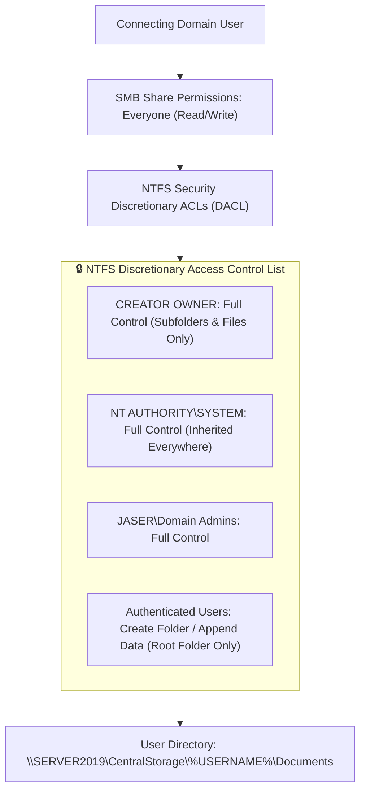

# Day 07: Centralized Data Redirection (GPO) & Share Architecture

[](../README.md)
[](../README.md)
[](../README.md)

---

## 🎯 7.1 Objective
The objective of Day 07 is to configure enterprise-grade **Folder Redirection** via Group Policy. By redirecting the standard `Documents` library from individual client endpoints to a central network share (`\\SERVER2019\CentralStorage`), user documents are safeguarded against local hardware failure, backed up centrally, and made accessible across multiple domain workstations.

---

## 🔬 7.2 Enterprise Architecture & "The Small Things"

### 1. The Critical Distinction: Share Permissions vs NTFS DACLs
A common vulnerability in file share administration is relying solely on basic SMB share permissions. To ensure enterprise security and absolute privacy across multi-user environments, we apply a two-tier permission model:



- **Why this matters**: With `CREATOR OWNER` assigned Full Control and standard users granted only *Create Folder / Append Data* on the root folder, Active Directory dynamically assigns ownership of `C:\CentralStorage\<Username>` to the user who logged in. **No standard user can browse or access another user's personal documents.**

### 2. GPO Folder Redirection Mechanics
- **Setting**: `Basic - Redirect everyone's folder to the same location`
- **Target Folder Location**: `Create a folder for each user under the root path`
- **Root Path**: `\\SERVER2019\CentralStorage`
- **Client-Side Caching (CSC / Offline Files)**: Automatically synchronizes files in the background, allowing users on mobile laptops to access their documents even when disconnected from the corporate LAN.

---

## 🛠️ 7.3 Implementation Steps

### Method 1: Graphical User Interface (GUI)
1. **Network Share & Directory Creation**:
   - Create local directory: `C:\CentralStorage`.
   - Right-click `CentralStorage` > **Properties** > **Sharing** > **Advanced Sharing**.
   - Check **Share this folder**, set Share Name: `CentralStorage`.
   - Set Share Permissions: `Everyone` -> **Read/Write** (Change, Read).
   - In the **Security** (NTFS) tab:
     - Ensure `SYSTEM` and `Administrators` have **Full Control**.
     - Ensure `Authenticated Users` have **Traverse/Execute & Create Folders** permissions.
2. **GPO Folder Redirection Configuration**:
   - Open **Group Policy Management** (`gpmc.msc`).
   - Create or edit a GPO linked to `OU=Jaser-Enterprise` (e.g., `Enterprise-Data-Redirection`).
   - Navigate to: `User Configuration > Policies > Windows Settings > Folder Redirection > Documents`.
   - Right-click **Documents** > Select **Properties**:
     - **Setting**: `Basic - Redirect everyone's folder to the same location`.
     - **Target folder location**: `Create a folder for each user under the root path`.
     - **Root Path**: `\\SERVER2019\CentralStorage`.
   - In the **Settings** tab:
     - Check: *Grant the user exclusive rights to Documents*.
     - Check: *Move the contents of Documents to the new location*.
   - Click **Apply** and **OK**.

---

## ⚡ 7.4 Automated PowerShell Deployment

```powershell
<#
.SYNOPSIS
    Day 07 - Automated SMB Share Provisioning, NTFS Permission Architecture, and Folder Redirection.
.DESCRIPTION
    Creates C:\CentralStorage, applies strict NTFS ACLs, provisions the SMB share, and verifies permissions.
#>

Write-Host "[+] Initializing Day 07 Centralized Storage & Redirection Setup..." -ForegroundColor Cyan

$StoragePath = "C:\CentralStorage"
$ShareName = "CentralStorage"

# 1. Directory Creation
if (-not (Test-Path -Path $StoragePath)) {
    Write-Host "[*] Creating storage directory: $StoragePath..." -ForegroundColor Yellow
    New-Item -Path $StoragePath -ItemType Directory -Force | Out-Null
}

# 2. Configure NTFS Discretionary Access Control Lists (DACL)
Write-Host "[*] Applying enterprise NTFS security descriptors..." -ForegroundColor Yellow

$Acl = Get-Acl -Path $StoragePath
# Disable inheritance and copy existing rules
$Acl.SetAccessRuleProtection($true, $true)

# Define explicit access rules
$AdminRule = New-Object System.Security.AccessControl.FileSystemAccessRule("BUILTIN\Administrators", "FullControl", "ContainerInherit,ObjectInherit", "None", "Allow")
$SystemRule = New-Object System.Security.AccessControl.FileSystemAccessRule("NT AUTHORITY\SYSTEM", "FullControl", "ContainerInherit,ObjectInherit", "None", "Allow")
$CreatorOwnerRule = New-Object System.Security.AccessControl.FileSystemAccessRule("CREATOR OWNER", "FullControl", "ContainerInherit,ObjectInherit", "InheritOnly", "Allow")
$AuthUsersRule = New-Object System.Security.AccessControl.FileSystemAccessRule("NT AUTHORITY\Authenticated Users", "CreateDirectories,AppendData,ReadAndExecute", "None", "None", "Allow")

# Apply rules
$Acl.ResetAccessRule($AdminRule)
$Acl.AddAccessRule($SystemRule)
$Acl.AddAccessRule($CreatorOwnerRule)
$Acl.AddAccessRule($AuthUsersRule)
Set-Acl -Path $StoragePath -AclObject $Acl

# 3. Create SMB Share
if (-not (Get-SmbShare -Name $ShareName -ErrorAction SilentlyContinue)) {
    Write-Host "[*] Provisioning SMB Share '\\SERVER2019\$ShareName'..." -ForegroundColor Yellow
    New-SmbShare -Name $ShareName -Path $StoragePath -FullAccess "Everyone" -Description "Centralized User Profile Redirection Repository"
} else {
    Write-Host "[=] SMB Share '$ShareName' already exists." -ForegroundColor Green
}

Write-Host "[+] CentralStorage share and NTFS security architecture successfully established." -ForegroundColor Green
```

---

## 🔍 7.5 Verification & Evidence

### Verification Commands
```powershell
# Verify SMB Share Details
Get-SmbShare -Name "CentralStorage" | Select-Object Name, Path, ScopeName, Description

# Verify Share Access Permissions
Get-SmbShareAccess -Name "CentralStorage"

# Verify Dynamic User Directory Creation after domain user logon
Get-ChildItem -Path "C:\CentralStorage" | Select-Object Name, CreationTime, Attributes
```

### Expected Output
```text
Name           Path              ScopeName Description
----           ----              --------- -----------
CentralStorage C:\CentralStorage *         Centralized User Profile Redirection Repository

AccountName AccessControlType AccessRight
----------- ----------------- -----------
Everyone    Allow             Full

Directory: C:\CentralStorage

Mode                LastWriteTime         Length Name
----                -------------         ------ ----
d-----         4/9/2026   6:21 PM                Jaser
d-----         4/9/2026   6:25 PM                jhalabi
```

---

## 📌 7.6 Key Takeaways & Sysadmin Insights
- **Automatic User Provisioning**: When user `Jaser` logs on, the Group Policy Client CSE (Client-Side Extension) detects the redirection policy, queries the share, and creates `C:\CentralStorage\Jaser\Documents` under the user's security token.
- **Exclusive Rights Flag**: Enabling "Grant the user exclusive rights" prevents even standard domain administrators from browsing the directory unless they take manual ownership and reset permissions, preserving user confidentiality.
