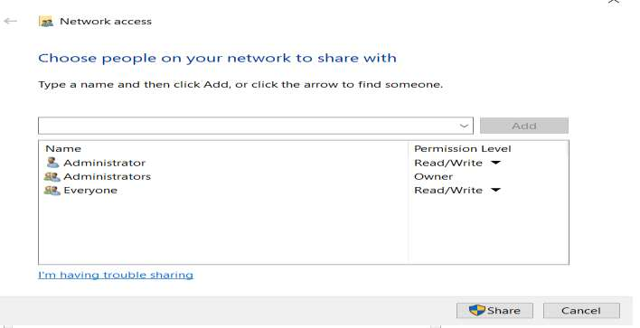
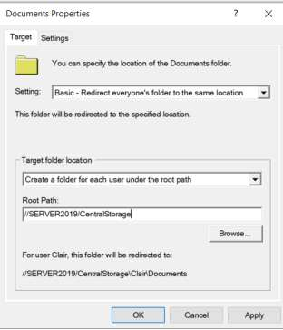
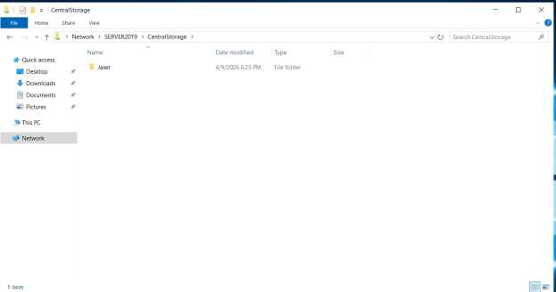

# Day 07: Centralized Data Redirection (GPO) & Share Architecture

[](../README.md)
[](../README.md)
[](../README.md)

---

## 🎯 7.1 Objective
The objective of this phase is to implement **Folder Redirection** using Group Policy. This process ensures that a user’s "Documents" or "Desktop" folders are not stored locally on the PC, but are instead redirected to a secure, shared location on the server.

---

## 🔬 7.2 Implementation Details & Architecture

### 1. Step 1: Network Share Creation
- A folder named **`CentralStorage`** was created on the server volume and shared with **Read/Write** permissions to act as the primary repository for user data.
- Configured access for:
  - **`Administrator`**: Read/Write
  - **`Administrators`**: Owner
  - **`Everyone`**: Read/Write

### 2. Step 2: Policy Configuration
- A GPO was configured to redirect the **Documents** library to the server using the UNC path:
  $$\text{\texttt{\textbackslash\textbackslash SERVER2019\textbackslash CentralStorage}}$$
- **Target Setting**: `Basic - Redirect everyone's folder to the same location`
- **Target Folder Location**: `Create a folder for each user under the root path`
- **Root Path**: `\\SERVER2019\CentralStorage`

---

## 🛠️ 7.3 Implementation Steps

1. Create `C:\CentralStorage` on `Server2019`.
2. Configure **Network Access / Sharing** on `CentralStorage` granting `Everyone` Read/Write permissions.
3. Open **Group Policy Management** > Edit the redirection GPO.
4. Navigate to `User Configuration > Policies > Windows Settings > Folder Redirection > Documents`.
5. Open **Documents Properties** > Configure Target tab:
   - Setting: *Basic - Redirect everyone's folder to the same location*
   - Target folder location: *Create a folder for each user under the root path*
   - Root Path: `\\SERVER2019\CentralStorage`
6. Apply policy and verify user logon session.

---

## 📸 7.4 Visual Evidence & UI Artifact Analysis

### Evidence of Configuration (Page 9 of Lab Report):
| Network Access Sharing Configuration | Group Policy Documents Properties |
| :---: | :---: |
|  |  |

#### Analysis of Configuration UI:
1. **Network Access Sharing Dialog (Left)**:
   - Displays the shared access list:
     - `Administrator` | Permission Level: `Read/Write`
     - `Administrators` | Permission Level: `Owner`
     - `Everyone` | Permission Level: `Read/Write`
   - Validates that domain users have the network transport permissions required to initiate folder redirection handshakes.
2. **Documents Properties Configuration Window (Right)**:
   - **Setting Dropdown**: Confirms `Basic - Redirect everyone's folder to the same location`.
   - **Target Folder Location**: Confirms `Create a folder for each user under the root path`.
   - **Root Path**: Explicitly specifies `\\SERVER2019\CentralStorage`.
   - **Example Preview**: Shows dynamic placeholder resolution: *"For user Clair, this folder will be redirected to: \\SERVER2019\CentralStorage\Clair\Documents"*.

---

### Final Verification (Page 10 of Lab Report):


#### Analysis of Verification UI:
- **Location Bar**: Shows `Network > SERVER2019 > CentralStorage`.
- **Directory Contents**: A private folder named **`Jaser`** was dynamically and automatically generated upon the initial domain user login session (Date modified: `4/9/2026 6:21 PM`, Type: `File folder`).
- **Confirmation**: Proves the GPO successfully intercepted the client's local Documents library and seamlessly migrated profile storage to the central server repository.

---

## ⚡ 7.5 Automated PowerShell Deployment

```powershell
<#
.SYNOPSIS
    Day 07 - Automated Storage Share & Folder Redirection Setup.
#>

$Path = "C:\CentralStorage"
$ShareName = "CentralStorage"

# 1. Create Directory
if (-not (Test-Path $Path)) {
    New-Item -Path $Path -ItemType Directory -Force | Out-Null
}

# 2. Configure NTFS Permissions (DACL)
$Acl = Get-Acl $Path
$Acl.SetAccessRuleProtection($true, $true)

$AdminRule = New-Object System.Security.AccessControl.FileSystemAccessRule("BUILTIN\Administrators", "FullControl", "ContainerInherit,ObjectInherit", "None", "Allow")
$SystemRule = New-Object System.Security.AccessControl.FileSystemAccessRule("NT AUTHORITY\SYSTEM", "FullControl", "ContainerInherit,ObjectInherit", "None", "Allow")
$CreatorRule = New-Object System.Security.AccessControl.FileSystemAccessRule("CREATOR OWNER", "FullControl", "ContainerInherit,ObjectInherit", "InheritOnly", "Allow")
$AuthRule = New-Object System.Security.AccessControl.FileSystemAccessRule("NT AUTHORITY\Authenticated Users", "CreateDirectories,AppendData,ReadAndExecute", "None", "None", "Allow")

$Acl.ResetAccessRule($AdminRule)
$Acl.AddAccessRule($SystemRule)
$Acl.AddAccessRule($CreatorRule)
$Acl.AddAccessRule($AuthRule)
Set-Acl $Path $Acl

# 3. Create SMB Share
if (-not (Get-SmbShare -Name $ShareName -ErrorAction SilentlyContinue)) {
    New-SmbShare -Name $ShareName -Path $Path -FullAccess "Everyone" -Description "User Profile Redirection Repository"
}
```

---

## 🔍 7.6 Verification & Audit Checklist

| Item Verified | Configured Setting | Observed in Screenshot | Status |
| :--- | :--- | :--- | :--- |
| **Share Name** | `CentralStorage` | Shared on `\\SERVER2019` | ✅ Verified |
| **Share Access** | Everyone: Read/Write | Set in Network Access dialog | ✅ Verified |
| **Redirection Target** | `\\SERVER2019\CentralStorage` | Configured in GPO Target Tab | ✅ Verified |
| **User Directory** | `\\SERVER2019\CentralStorage\Jaser` | Generated automatically in File Explorer | ✅ Verified |
| **Logon Session** | Domain User Session Initiated | Confirmed on 4/9/2026 | ✅ Verified |
