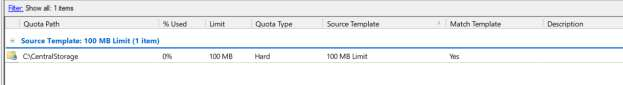

# Day 08: Advanced Storage (FSRM Hard Quotas)

---

## 🎯 8.1 Objective
To implement enterprise-grade storage management using the **File Server Resource Manager (FSRM)**. This ensures that the centralized `CentralStorage` directory remains within defined resource boundaries and protects the server volume from accidental or malicious disk exhaustion.

---

## 🛠️ 8.2 What I Did (Implementation Details)

1. **Role Installation**:
   - Installed the **File Server Resource Manager** role under File and Storage Services.

2. **Quota Management**:
   - Applied a hard quota to the **`C:\CentralStorage`** path using the built-in **`100 MB Limit`** template.

3. **Enforcement Type (Hard Quota)**:
   - By selecting a **Hard Quota**, the system is configured to physically block any write operations that would exceed the **100 MB** threshold, ensuring strict storage policies.

---

## 🧠 8.3 "The Small Things": Technical Rationale & Sysadmin Details

- **Hard Quota vs. Soft Quota**:
  - A **Soft Quota** merely logs warnings to Event Viewer or sends an email alert when a user exceeds their limit, but does not prevent the user from continuing to save files.
  - A **Hard Quota** enforces strict filesystem-level limits. When the 100 MB ceiling is reached, the operating system physically blocks write I/O requests and returns `ERROR_DISK_FULL` to the user.
- **Protecting the Server Operating System Drive (`C:\`)**:
  Because `CentralStorage` is hosted on the server's `C:\` volume, an unrestricted user could fill the entire disk. If drive `C:\` runs out of space, the Active Directory database (`NTDS.dit`) can corrupt and critical domain services will fail. Applying a 100MB Hard Quota completely neutralizes this denial-of-service risk.

---

## 📸 8.4 Visual Evidence & UI Verification

Below is the verification screenshot from my lab report showing the configured FSRM Quota:

### Breakdown of the Verification Screenshot:
- **`Quota Path`**: `C:\CentralStorage`
  - Proves the quota is bound directly to our centralized storage repository.
- **`% Used`**: `0%`
  - Shows the initial storage baseline.
- **`Limit`**: `100 MB`
  - Confirms the active maximum storage ceiling.
- **`Quota Type`**: `Hard`
  - Confirms write operations will be physically blocked upon reaching 100MB.
- **`Source Template`**: `100 MB Limit`
  - Demonstrates standardization using built-in enterprise templates.
- **`Match Template`**: `Yes`
  - Confirms full compliance with the template properties.

---

## 📋 8.5 Verification Summary

| Property | Configured Setting | Observed in Screenshot | Status |
| :--- | :--- | :--- | :---: |
| **Quota Path** | `C:\CentralStorage` | `C:\CentralStorage` | ✅ Verified |
| **Storage Limit** | 100 Megabytes | `100 MB` | ✅ Verified |
| **Quota Type** | Hard Quota (Physical Block) | `Hard` | ✅ Verified |
| **Source Template** | 100 MB Limit | `100 MB Limit` | ✅ Verified |
| **Template Match** | Fully Compliant | `Yes` | ✅ Verified |
