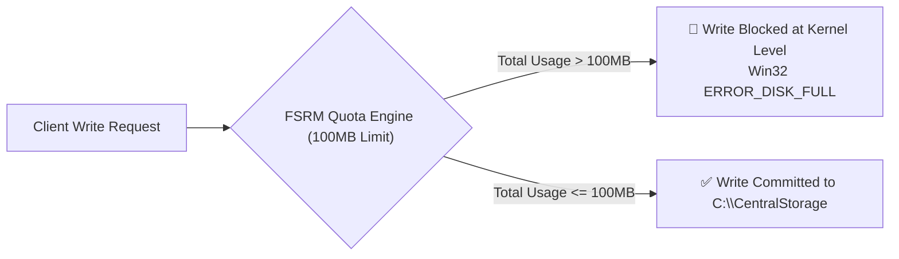

# Day 08: Advanced Storage Management (FSRM Hard Quotas)

[](../README.md)
[](../README.md)
[](../README.md)

---

## 🎯 8.1 Objective
The objective of this phase is to implement enterprise-grade storage management using the **File Server Resource Manager (FSRM)**. This ensures that the centralized `CentralStorage` directory remains within defined resource boundaries and protects the server volume from accidental or malicious disk exhaustion.

---

## 🔬 8.2 Implementation Details & Architecture

### 1. Quota Management
- A hard quota was applied to the **`C:\CentralStorage`** path using the built-in **`100 MB Limit`** template.

### 2. Enforcement Type: Hard Quota
- By selecting a **Hard Quota**, the system is configured to physically block any write operations that would exceed the **100 MB** threshold, ensuring strict storage policies.
- In contrast to a Soft Quota (which only logs alerts), a Hard Quota commands the NTFS filesystem driver to return `ERROR_DISK_FULL` when the allocated space ceiling is breached.



---

## 🛠️ 8.3 Implementation Steps

1. Install the **File Server Resource Manager** role feature.
2. Open **File Server Resource Manager** (`fsrm.msc`).
3. Expand **Quota Management** > Right-click **Quotas** > Select **Create Quota...**.
4. Set Quota path: `C:\CentralStorage`.
5. Select **Derive properties from this quota template (recommended)**.
6. Choose template: **100 MB Limit**.
7. Ensure Quota Type is set to **Hard Quota**.
8. Click **Create**.

---

## 📸 8.4 Visual Evidence & UI Artifact Analysis


### Deep-Dive Analysis of the Screenshot:
1. **Quota Management Grid**:
   - **`Quota Path`**: `C:\CentralStorage`
     - Validates the policy is bound directly to the root of the user redirection folder tree.
   - **`% Used`**: `0%`
     - Displays current storage utilization baseline.
   - **`Limit`**: `100 MB`
     - Confirms the exact numerical storage ceiling applied to the directory.
   - **`Quota Type`**: `Hard`
     - Confirms deterministic write blocking rather than passive monitoring.
   - **`Source Template`**: `100 MB Limit`
     - Proves standard template inheritance for centralized management.
   - **`Match Template`**: `Yes`
     - Confirms the quota properties are fully compliant with the enterprise template definition.

---

## ⚡ 8.5 Automated PowerShell Deployment

```powershell
<#
.SYNOPSIS
    Day 08 - Automated FSRM Installation and 100MB Hard Quota Enforcement.
#>

# 1. Install FSRM Role
Install-WindowsFeature -Name FS-Resource-Manager -IncludeManagementTools

# 2. Configure 100MB Hard Quota
$QuotaPath = "C:\CentralStorage"
$TemplateName = "100 MB Limit"

if (-not (Test-Path $QuotaPath)) {
    New-Item -Path $QuotaPath -ItemType Directory -Force | Out-Null
}

if (-not (Get-FsrmQuota -Path $QuotaPath -ErrorAction SilentlyContinue)) {
    New-FsrmQuota -Path $QuotaPath -Template $TemplateName -ErrorAction Stop
} else {
    Set-FsrmQuota -Path $QuotaPath -Template $TemplateName
}
```

---

## 🔍 8.6 Verification & Audit Checklist

| Property | Configured Setting | Observed in Screenshot | Status |
| :--- | :--- | :--- | :--- |
| **Quota Path** | `C:\CentralStorage` | `C:\CentralStorage` | ✅ Verified |
| **Limit** | 100 Megabytes | `100 MB` | ✅ Verified |
| **Quota Type** | Hard Quota (Physical Block) | `Hard` | ✅ Verified |
| **Source Template** | 100 MB Limit | `100 MB Limit` | ✅ Verified |
| **Template Match** | Fully Compliant | `Yes` | ✅ Verified |
