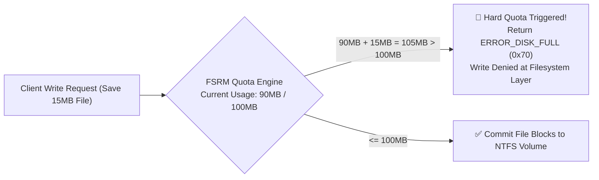

# Day 08: Advanced Storage Management (FSRM Hard Quotas)

[](../README.md)
[](../README.md)
[](../README.md)

---

## 🎯 8.1 Objective
The objective of Day 08 is to install and configure **File Server Resource Manager (FSRM)** to enforce deterministic storage boundaries on the centralized data repository (`C:\CentralStorage`). By applying a **100 MB Hard Quota**, we prevent server volume exhaustion, mitigate Denial-of-Service (DoS) storage fill attacks, and control storage infrastructure growth.

---

## 🔬 8.2 Enterprise Architecture & "The Small Things"

### 1. Hard Quota vs Soft Quota Mechanics

| Feature | Hard Quota (Implemented) | Soft Quota (Monitoring Only) |
| :--- | :--- | :--- |
| **Write I/O Enforcement** | **Physically halts write operations** when the storage threshold is reached. | Allows users to write past the limit without restriction. |
| **Client Error Code** | Returns standard Win32 error `ERROR_DISK_FULL` (`0x70` / `112`) to calling applications. | No error returned to client application. |
| **Use Case** | Mission-critical multi-tenant shares, roaming profiles, and shared departmental pools. | Capacity planning, trend analysis, and pre-quota audit baselines. |
| **Notifications** | Generates Event Log entries, optional SMTP email alerts, and triggers scripts. | Generates notifications only; does not stop data writing. |



### 2. Protecting the Server Operating System Volume (`C:\`)
Because `CentralStorage` resides on the system volume (`C:\CentralStorage`), an unrestricted user could inadvertently or maliciously download large files until the entire disk fills to 0 bytes free. In Windows Server, a full system drive causes Active Directory database (`NTDS.dit`) corruption, prevents Kerberos ticket issuance, and halts critical Windows services. Hard Quotas provide an immutable safeguard against this catastrophic failure mode.

---

## 🛠️ 8.3 Implementation Steps

### Method 1: Graphical User Interface (GUI)
1. **FSRM Role Installation**:
   - Open **Server Manager** > **Add Roles and Features**.
   - Navigate to: **Server Roles** > **File and Storage Services** > **File and iSCSI Services** > Check **File Server Resource Manager**.
   - Include RSAT management tools and complete the installation.
2. **Quota Creation**:
   - Open **File Server Resource Manager** (`fsrm.msc`).
   - Expand **Quota Management** > Right-click **Quotas** > Select **Create Quota...**.
   - In the Create Quota dialog:
     - **Quota path**: `C:\CentralStorage`.
     - Select: **Create quota on path**.
     - Select **Derive properties from this quota template (recommended)**.
     - Choose template: **100 MB Limit**.
     - Verify Quota Type is set to **Hard Quota**.
   - Click **Create**.

---

## ⚡ 8.4 Automated PowerShell Deployment

```powershell
<#
.SYNOPSIS
    Day 08 - Automated FSRM Installation and 100MB Hard Quota Enforcement.
.DESCRIPTION
    Installs File Server Resource Manager and configures a 100MB Hard Quota on C:\CentralStorage.
#>

Write-Host "[+] Initializing Day 08 FSRM Quota Management..." -ForegroundColor Cyan

# 1. Install FSRM Role & Tools
Write-Host "[*] Installing File Server Resource Manager role..." -ForegroundColor Yellow
Install-WindowsFeature -Name FS-Resource-Manager -IncludeManagementTools

# 2. Configure 100MB Hard Quota
$QuotaPath = "C:\CentralStorage"
$TemplateName = "100 MB Limit"

Write-Host "[*] Applying 100MB Hard Quota to $QuotaPath..." -ForegroundColor Yellow

# Verify path existence
if (-not (Test-Path $QuotaPath)) {
    New-Item -Path $QuotaPath -ItemType Directory -Force | Out-Null
}

# Create Quota using built-in template
if (-not (Get-FsrmQuota -Path $QuotaPath -ErrorAction SilentlyContinue)) {
    New-FsrmQuota -Path $QuotaPath -Template $TemplateName -ErrorAction Stop
    Write-Host "[+] Hard Quota applied successfully to $QuotaPath using template '$TemplateName'." -ForegroundColor Green
} else {
    Write-Host "[*] Updating existing quota to enforce Hard Limit template '$TemplateName'..." -ForegroundColor Yellow
    Set-FsrmQuota -Path $QuotaPath -Template $TemplateName
    Write-Host "[+] Quota updated." -ForegroundColor Green
}
```

---

## 🔍 8.5 Verification & Evidence

### Verification Commands
```powershell
# Query FSRM Quota Configuration
Get-FsrmQuota -Path "C:\CentralStorage" | Select-Object Path, Size, QuotaType, MatchesSourceTemplate, PeakUsage

# Format Quota Size in Megabytes
Get-FsrmQuota -Path "C:\CentralStorage" | Select-Object Path, @{Name="Limit (MB)"; Expression={$_.Size / 1MB}}, QuotaType
```

### Expected Output
```text
Path              Limit (MB) QuotaType
----              ---------- ---------
C:\CentralStorage        100      Hard

MatchesSourceTemplate : True
PeakUsage             : 0
Size                  : 104857600
```

---

## 📌 8.6 Key Takeaways & Sysadmin Insights
- **Immediate Rejection**: Unlike NTFS Disk Quotas (which calculate usage based on user file ownership across entire volumes), FSRM Quotas evaluate directory tree consumption in real-time, providing immediate enforcement regardless of ownership changes.
- **Template Inheritance**: Using standard templates allows sysadmins to modify the parent template (e.g., expanding from 100MB to 250MB) and automatically propagate the update across all associated shares.
