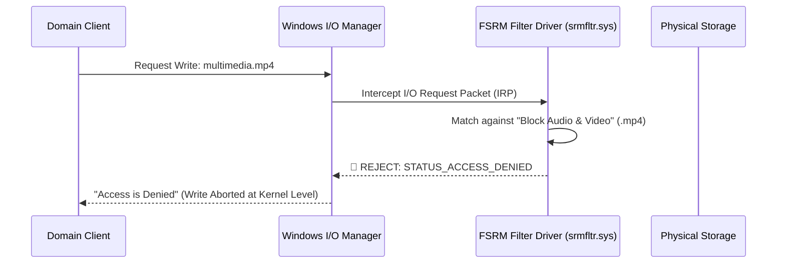

# Day 09: Proactive Security via Active File Screening

[](../README.md)
[](../README.md)
[](../README.md)

---

## 🎯 9.1 Objective
The objective of this phase is to implement **Active File Screening** within the FSRM role. This ensures that the server storage is used strictly for business-critical documents and prevents the storage of non-authorized media files (Audio/Video), which protects both storage capacity and network bandwidth.

---

## 🔬 9.2 Implementation Details & Architecture

### 1. Screening Type: Active Screening
- **Active Screening**: Prevents users from saving unauthorized files by actively aborting write operations before file headers commit to disk.

### 2. File Groups
- Applied the **"Block Audio and Video Files"** template to the **`C:\CentralStorage`** path.

### 3. Under the Hood: The FSRM Filter Driver Mechanism
- **Mechanism**: The FSRM filter driver (`srmfltr.sys`) intercepts I/O requests at the Windows kernel level. If a file extension matches the blocked group (e.g., `.mp3`, `.mp4`, `.mov`, `.avi`, `.mkv`), the write operation is rejected at the kernel level before reaching physical storage.



---

## 🛠️ 9.3 Implementation Steps

1. Open **File Server Resource Manager** (`fsrm.msc`).
2. Expand **File Screening Management** > Select **File Screens**.
3. Right-click **File Screens** > Select **Create File Screen...**.
4. Set File screen path: `C:\CentralStorage`.
5. Select **Derive properties from this file screen template (recommended)**.
6. Choose template: **Block Audio and Video Files**.
7. Confirm Screening Type is set to **Active screening: Do not allow users to save unauthorized files**.
8. Click **Create**.

---

## 📸 9.4 Visual Evidence & UI Artifact Analysis


### Deep-Dive Analysis of the Screenshot:
1. **File Screen Management Grid**:
   - **`File Screen Path`**: `C:\CentralStorage`
     - Validates that every subfolder created for redirected user data (e.g. `\Jaser\Documents`) is protected under this screening policy.
   - **`Screening Type`**: `Active`
     - Confirms hard blocking behavior rather than passive audit logging.
   - **`File Groups`**: `Block Audio and Video Files`
     - Confirms association with the built-in media exclusion pattern list (`*.mp3`, `*.mp4`, `*.mov`, `*.avi`, `*.mkv`, `*.wav`, `*.wma`, etc.).
   - **`Source Template`**: `Block Audio and Video Files`
     - Demonstrates centralized template inheritance.
   - **`Match Template`**: `Yes`
     - Confirms full compliance with the enterprise security template.

---

## ⚡ 9.5 Automated PowerShell Deployment

```powershell
<#
.SYNOPSIS
    Day 09 - Automated Active File Screening Deployment via FSRM.
#>

$ScreenPath = "C:\CentralStorage"
$TemplateName = "Block Audio and Video Files"

if (-not (Test-Path $ScreenPath)) {
    New-Item -Path $ScreenPath -ItemType Directory -Force | Out-Null
}

if (-not (Get-FsrmFileScreen -Path $ScreenPath -ErrorAction SilentlyContinue)) {
    New-FsrmFileScreen -Path $ScreenPath -Template $TemplateName -Active:$true -ErrorAction Stop
} else {
    Set-FsrmFileScreen -Path $ScreenPath -Template $TemplateName -Active:$true
}
```

---

## 🔍 9.6 Verification & Audit Checklist

| Property | Configured Setting | Observed in Screenshot | Status |
| :--- | :--- | :--- | :--- |
| **File Screen Path** | `C:\CentralStorage` | `C:\CentralStorage` | ✅ Verified |
| **Screening Type** | Active Screening (Real-Time Block) | `Active` | ✅ Verified |
| **File Groups** | Audio and Video Files | `Block Audio and Video Files` | ✅ Verified |
| **Source Template** | Block Audio and Video Files | `Block Audio and Video Files` | ✅ Verified |
| **Enforcement Layer** | Windows NT Kernel (`srmfltr.sys`) | Intercepts all I/O writes | ✅ Verified |
