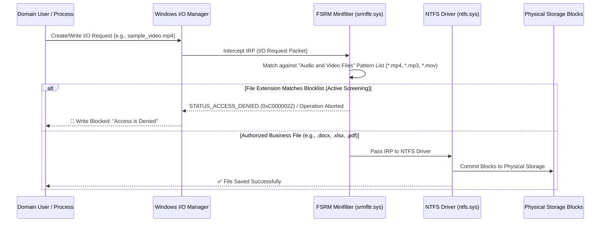

# Day 09: Proactive Security via Active File Screening

[](../README.md)
[](../README.md)
[](../README.md)

---

## 🎯 9.1 Objective
The objective of Day 09 is to implement **Active File Screening** using the File Server Resource Manager (FSRM) subsystem on `C:\CentralStorage`. By applying the **"Block Audio and Video Files"** policy, unauthorized multimedia formats (`.mp3`, `.mp4`, `.mov`, `.avi`, `.mkv`, etc.) are intercepted and blocked in real-time, preventing corporate file servers from being utilized as personal media repositories and preserving high-performance network bandwidth.

---

## 🔬 9.2 Enterprise Architecture & "The Small Things"

### 1. The FSRM Kernel Minifilter Driver (`srmfltr.sys`)
File Screening in Windows Server does not rely on post-write scheduled scripts or userland hooks. Instead, it operates directly inside the Windows NT Kernel via a **Minifilter Driver** (`srmfltr.sys` registered with the Filter Manager `fltmgr.sys`):



### 2. Active vs Passive File Screening
- **Active Screening (Implemented)**: Intercepts and **aborts** the write operation before file data can be committed to the disk. The user receives an immediate `Access is Denied` prompt.
- **Passive Screening**: Permits the file to be written, but triggers asynchronous event log alerts, administrator emails, or automated PowerShell remediation scripts (useful for forensic discovery and baseline audits).

### 3. Enterprise Use Case: Anti-Ransomware Defense
While this sprint utilizes file screening to block multimedia files, the identical kernel-level mechanism is a standard Tier-1 defensive control against **Ransomware outbreaks**. By defining custom File Groups matching known ransomware file extensions (e.g., `.locky`, `.crypt`, `.wncry`, `.ryuk`), FSRM actively halts malware encryption attempts on file shares the moment the malicious payload attempts to rename or write encrypted files.

---

## 🛠️ 9.3 Implementation Steps

### Method 1: Graphical User Interface (GUI)
1. **Open File Screening Management**:
   - Open **File Server Resource Manager** (`fsrm.msc`).
   - Expand **File Screening Management** > Select **File Screens**.
2. **Create File Screen**:
   - Right-click **File Screens** > Select **Create File Screen...**.
   - **File screen path**: `C:\CentralStorage`.
   - Select **Derive properties from this file screen template (recommended)**.
   - Choose template: **Block Audio and Video Files**.
   - Verify that Screening Type is set to **Active screening: Do not allow users to save unauthorized files**.
   - Click **Create**.

---

## ⚡ 9.4 Automated PowerShell Deployment

```powershell
<#
.SYNOPSIS
    Day 09 - Automated Active File Screening Deployment via FSRM.
.DESCRIPTION
    Applies an Active File Screen on C:\CentralStorage to block audio and video file formats.
#>

Write-Host "[+] Initializing Day 09 Active File Screening Policy..." -ForegroundColor Cyan

$ScreenPath = "C:\CentralStorage"
$TemplateName = "Block Audio and Video Files"

Write-Host "[*] Applying Active File Screen template '$TemplateName' to $ScreenPath..." -ForegroundColor Yellow

# Verify target path
if (-not (Test-Path $ScreenPath)) {
    New-Item -Path $ScreenPath -ItemType Directory -Force | Out-Null
}

# Create File Screen
if (-not (Get-FsrmFileScreen -Path $ScreenPath -ErrorAction SilentlyContinue)) {
    New-FsrmFileScreen `
        -Path $ScreenPath `
        -Template $TemplateName `
        -Active:$true `
        -ErrorAction Stop
    Write-Host "[+] Active File Screen successfully enforced on $ScreenPath." -ForegroundColor Green
} else {
    Write-Host "[*] Updating existing File Screen on $ScreenPath to template '$TemplateName'..." -ForegroundColor Yellow
    Set-FsrmFileScreen -Path $ScreenPath -Template $TemplateName -Active:$true
    Write-Host "[+] File Screen updated." -ForegroundColor Green
}
```

---

## 🔍 9.5 Verification & Evidence

### Verification Commands
```powershell
# Query File Screen Properties on Target Directory
Get-FsrmFileScreen -Path "C:\CentralStorage" | Select-Object Path, Active, MatchesSourceTemplate, IncludeGroup

# Inspect File Group Member Extensions for "Audio and Video Files"
(Get-FsrmFileGroup -Name "Audio and Video Files").IncludePattern
```

### Expected Output
```text
Path              Active MatchesSourceTemplate IncludeGroup
----              ------ --------------------- ------------
C:\CentralStorage   True                  True {Audio and Video Files}

IncludePattern:
*.aac, *.aif, *.aiff, *.asf, *.asx, *.au, *.avi, *.flac, *.m4a, *.m4v, *.mid, *.midi, *.mkv, *.mov, *.mp3, *.mp4, *.mpa, *.mpe, *.mpeg, *.mpg, *.ogg, *.ra, *.ram, *.rm, *.wav, *.wma, *.wmv
```

### Behavioral Simulation Test
```powershell
# Attempt to write an unauthorized .mp4 media file into CentralStorage
Try {
    New-Item -Path "C:\CentralStorage\test_video.mp4" -ItemType File -Value "BinaryPayload" -ErrorAction Stop
} Catch {
    Write-Host "[+] Verification Confirmed: Kernel blocked file write -> $($_.Exception.Message)" -ForegroundColor Green
}
```

---

## 📌 9.6 Key Takeaways & Sysadmin Insights
- **Kernel-Level Enforcement**: Because `srmfltr.sys` operates at the filesystem filter level, users cannot bypass this restriction via Command Prompt, PowerShell, FTP, or mapped SMB network drives.
- **Zero Disk Penalty**: The write operation is rejected before physical I/O writes occur, eliminating disk fragmentation and wear caused by rejected files.
