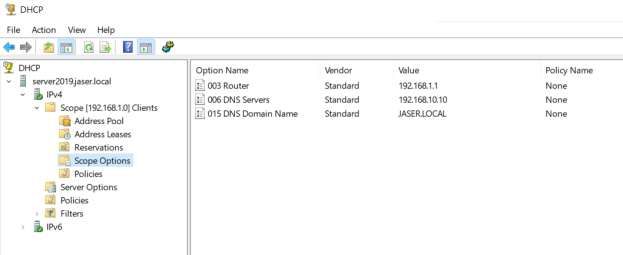

# DHCP Server Configuration & Enterprise Options

---

## 🎯 5.1 Objective
To automate IP address management for the **`JASER.LOCAL`** domain by configuring a dedicated DHCP scope and options.

---

## 🛠️ 5.2 Implementation Steps

- **Scope Provisioning**: Initialized an IPv4 scope (**`192.168.1.0`**) to manage the distribution of dynamic addresses.
- **Option Configuration**: Configured standard DHCP options to streamline client connectivity:
  - **`003 Router`**: Set to **`192.168.1.1`** to provide the default gateway.
  - **`006 DNS Servers`**: Pointed to the local server **`192.168.10.10`** for domain name resolution.
  - **`015 DNS Domain Name`**: Appended the **`JASER.LOCAL`** suffix to all leased clients.

---

## 📸 5.3 Visual Evidence & Verification

### Verification Details from DHCP Manager:
- **Left Console Tree**:
  - DHCP Server: `server2019.jaser.local`.
  - Active Scope: `Scope [192.168.1.0] Clients`.
  - Selected node: `Scope Options`.
- **Right Scope Options Grid**:
  - **`003 Router`** | Value: `192.168.1.1`
  - **`006 DNS Servers`** | Value: `192.168.10.10`
  - **`015 DNS Domain Name`** | Value: `JASER.LOCAL`

---

## 📋 5.4 Configuration Summary

| Option Code | Option Name | Configured Value | Verification Status |
| :--- | :--- | :--- | :---: |
| **003** | Router | `192.168.1.1` | ✅ Verified |
| **006** | DNS Servers | `192.168.10.10` | ✅ Verified |
| **015** | DNS Domain Name | `JASER.LOCAL` | ✅ Verified |
| **Scope** | IPv4 Scope | `192.168.1.0` | ✅ Verified |
